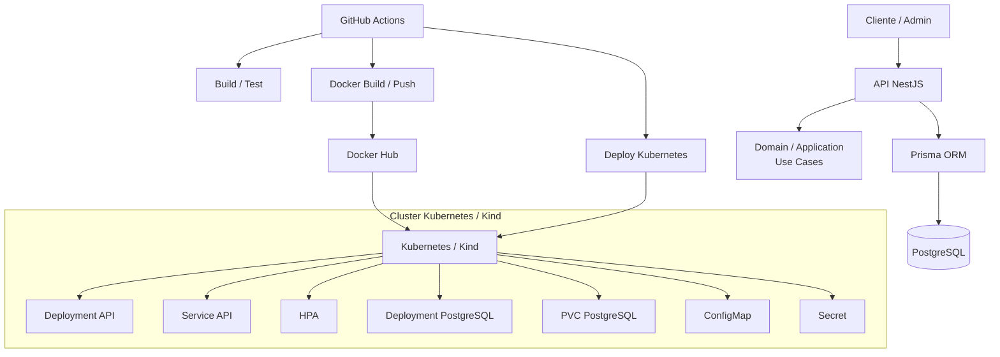

# Tech Challenge 02 - Fase 2

## Sistema Integrado de Atendimento e Execução de Serviços para Oficina Mecânica

**Aluno:** João Pedro do Carmo Ribeiro  
**RM:** 370432  
**Grupo:** Leão da Programação na Hora Extra  
**Discord:** joaogw  
**Repositório:** https://github.com/JoaoGW/FIAP_TechChallenges  
**Status do compartilhamento:** repositório compartilhado com o usuário `soat-architecture`.  
**Vídeo demonstrativo:** pendente de gravação ao final da entrega.

---

## 1. Resumo da Fase 2

A Fase 2 evolui o MVP do Sistema Integrado de Atendimento e Execução de Serviços para Oficina Mecânica com foco em arquitetura, infraestrutura, escalabilidade, automação de deploy e documentação operacional.

Nesta fase, o projeto passou a contemplar containerização com Docker, orquestração com Kubernetes, provisionamento local com Terraform e Kind, pipeline de CI/CD com GitHub Actions, migrations versionadas com Prisma e collection de APIs para validação dos fluxos principais.

Também foram feitos refinamentos na organização da aplicação para manter a separação entre regras de domínio, casos de uso, infraestrutura, adapters e controllers HTTP. A intenção foi preservar o núcleo do negócio isolado dos detalhes de framework, banco de dados e transporte HTTP.

---

## 2. Escopo funcional da Fase 2

O sistema permite administrar clientes, veículos, serviços, peças e ordens de serviço de uma oficina mecânica.

A Ordem de Serviço é o agregado principal do domínio e percorre o fluxo operacional abaixo:

```text
RECEBIDA -> EM_DIAGNOSTICO -> AGUARDANDO_APROVACAO -> EM_EXECUCAO -> FINALIZADA -> ENTREGUE
```

Também foi adicionada a possibilidade de cancelamento quando o cliente recusa o orçamento:

```text
AGUARDANDO_APROVACAO -> CANCELADA
```

A API contempla abertura de OS, adição de serviços e peças, geração de orçamento, envio para aprovação, aprovação ou recusa do orçamento, início da execução, finalização do serviço, entrega do veículo e consulta pública de status por código de acompanhamento.

Na abertura, a OS pode receber serviços e peças opcionais. Os valores são registrados como snapshots dentro da ordem, o que preserva o histórico mesmo quando os preços cadastrados no catálogo forem alterados depois.

---

## 3. Arquitetura da aplicação

A aplicação utiliza NestJS com TypeScript, seguindo uma arquitetura em camadas inspirada em DDD e Clean Architecture.

As principais camadas são:

- `domain`: entidades, value objects, enums, erros de domínio e contratos de repositório.
- `application`: casos de uso e portas de saída para integrações externas.
- `infrastructure`: Prisma, repositórios concretos, mappers, adapters de email e webhook.
- `interfaces`: controllers HTTP, DTOs, guards e strategies.
- `modules`: composição dos módulos NestJS e injeção de dependências.

A regra de dependência adotada é que o domínio não depende de nenhuma camada externa. A aplicação depende do domínio e de suas portas. A infraestrutura implementa os contratos definidos pelo domínio e pela aplicação. A camada de interfaces expõe os endpoints HTTP e aciona os casos de uso.

Como exceção documentada do MVP, o caso de uso de login utiliza diretamente `JwtService` e `ConfigService` do NestJS. As integrações de email e token de webhook, por outro lado, são acessadas por portas de saída e implementadas por adapters de infraestrutura.

---

## 4. Modelagem DDD da Fase 2

A modelagem DDD da Fase 2 está documentada no arquivo:

```text
docs/modelagem-ddd-fase-2.md
```

Esse documento registra a linguagem ubíqua, Domain Storytelling, Event Storming, contextos delimitados, agregados, comandos, eventos e políticas de domínio.

Os principais contextos delimitados identificados foram:

- **Atendimento:** cadastro de cliente, veículo, abertura de OS e consulta pública.
- **Oficina / Execução:** diagnóstico, orçamento, execução, finalização e entrega.
- **Catálogo:** serviços, peças e controle de estoque.
- **Comunicação:** envio de orçamento, email, token e webhook de aprovação ou recusa.

A `OrdemDeServico` é o Aggregate Root central. Ela protege as transições de status, mantém os itens de serviço e peça adicionados à OS e impede que uma ordem cancelada, finalizada ou entregue volte para a fila operacional. A peça mantém a regra de estoque não negativo, sendo que a baixa ocorre no início da execução, depois da aprovação do orçamento.

O documento também registra que cliente e veículo são agregados separados. Antes de abrir uma OS, o caso de uso valida se o veículo informado pertence ao cliente selecionado.

---

## 5. Diagrama de arquitetura

**Figura 1 - Arquitetura da aplicação e fluxo de entrega.**



O deploy local da Fase 2 usa um cluster Kubernetes Kind provisionado via Terraform. O pipeline de CD publica a imagem no Docker Hub e aplica os manifestos Kubernetes no cluster por meio de um runner self-hosted executando no Mac local, já que o kubeconfig do Kind aponta para `127.0.0.1`.

O HPA é aplicado sobre o Deployment da API. Ele trabalha com métricas de CPU e memória e ajusta a quantidade de pods entre o mínimo e o máximo configurados. Para que as métricas sejam coletadas no cluster, é necessário manter o `metrics-server` instalado e configurado.

---

## 6. Infraestrutura com Docker

A aplicação foi containerizada com Docker. O projeto possui `Dockerfile` multi-stage para build da API e `docker-compose.yml` para execução local com PostgreSQL.

No ambiente Docker Compose, a API acessa o banco pelo hostname interno `postgres`, disponibilizado pela rede do Compose. Já no ambiente local fora do Docker, a conexão utiliza `localhost`. Por isso o projeto separa os arquivos `.env` e `.env.docker`.

O container de produção utiliza Node.js 20 Alpine, instala apenas as dependências necessárias para execução, gera o Prisma Client e expõe a porta 3000. No Compose, a API aguarda a verificação de saúde do PostgreSQL antes de iniciar e executa as migrations antes de subir a aplicação.

---

## 7. Infraestrutura com Kubernetes

Os manifests Kubernetes ficam no diretório `k8s/` e incluem:

- `namespace.yaml`: namespace da aplicação.
- `configmap.yaml`: variáveis não sensíveis.
- `secret.example.yaml`: modelo de Secret sem valores reais.
- `pvc-postgres.yaml`: volume persistente do PostgreSQL.
- `deployment-postgres.yaml`: Deployment do banco.
- `service-postgres.yaml`: Service interno do banco.
- `deployment-api.yaml`: Deployment da API.
- `service-api.yaml`: Service da API.
- `hpa.yaml`: Horizontal Pod Autoscaler da API.

O Deployment da API possui duas réplicas iniciais, requests e limits de CPU e memória, além de `readinessProbe` e `livenessProbe` na rota `/docs-json`. O Service da API expõe a porta 80 e encaminha o tráfego para a porta 3000 do container.

O HPA usa a API `autoscaling/v2`, com mínimo de 2 e máximo de 10 réplicas. A escala é calculada pela utilização média de CPU, com alvo de 70%, e de memória, com alvo de 80%. Para esse funcionamento, o `metrics-server` deve estar instalado no cluster e os requests dos containers precisam estar definidos, pois a utilização percentual é calculada a partir desses requests.

O PostgreSQL é executado em um Deployment próprio, com Service interno `postgres-service` e PVC de 1 GiB. A aplicação utiliza o hostname interno desse Service para se conectar ao banco dentro do cluster.

---

## 8. Infraestrutura com Terraform

Os scripts Terraform ficam no diretório `infra/` e provisionam a infraestrutura local necessária para a entrega.

Recursos provisionados:

- `kind_cluster.oficina`: cluster Kubernetes local com Kind.
- `kubernetes_namespace.oficina`: namespace `oficina`.
- `kubernetes_config_map.oficina_config`: ConfigMap da aplicação.
- `kubernetes_secret.oficina_secrets`: Secret da aplicação.
- `kubernetes_persistent_volume_claim.postgres`: PVC do PostgreSQL.
- `kubernetes_deployment.postgres`: Deployment do PostgreSQL.
- `kubernetes_service.postgres`: Service interno do PostgreSQL.
- `null_resource.export_kubeconfig`: exportação do kubeconfig local.

O cluster é configurado com um control-plane e workers ajustáveis por variável. A porta da API também pode ser definida por variável, o que permite utilizar uma porta local diferente de 3000 durante os testes.

O Terraform foi validado com `terraform validate` e `terraform plan`. Durante os testes locais, foram considerados os ajustes necessários para compatibilidade com o provider Kind e com o comportamento de PVC em cluster local. As variáveis de senha do banco, JWT, webhook, SMTP e hash da senha administrativa são marcadas como sensíveis no código de infraestrutura.

Os manifests equivalentes permanecem em `k8s/` para uso pelo pipeline de CD e para disponibilizar a infraestrutura também em YAML, separada da definição em Terraform.

---

## 9. CI/CD

O projeto possui workflows GitHub Actions em `.github/workflows/`.

O workflow de CI é executado em todo push e em pull requests direcionados para `master`. Ele realiza:

- checkout do código;
- setup do Node.js 20;
- `npm ci`;
- geração do Prisma Client;
- build da aplicação;
- execução das migrations em banco PostgreSQL de teste;
- testes unitários;
- cobertura de testes;
- testes e2e.

O workflow de CD executa em push para `master`. Ele realiza:

- login no Docker Hub;
- build da imagem Docker;
- push das tags `latest` e `sha-<hash>`;
- configuração do `kubectl`;
- materialização do Secret Kubernetes;
- deploy do PostgreSQL;
- deploy da API;
- atualização da imagem do Deployment;
- aplicação do HPA;
- execução das migrations com Prisma;
- verificação final de pods, Services, HPA e Deployment.

O build e o push da imagem Docker executam em `ubuntu-latest`. Como o cluster Kind roda localmente, o job de deploy utiliza runner self-hosted macOS. Isso permite que o `kubectl` do pipeline alcance o kubeconfig e o endpoint local do cluster.

---

## 10. Secrets do pipeline

Os secrets configurados no GitHub Actions são:

- `DOCKER_USERNAME`: usuário Docker Hub.
- `DOCKER_PASSWORD`: token Docker Hub.
- `DOCKER_IMAGE_NAME`: imagem publicada, no formato `usuario/oficina-api`.
- `KUBECONFIG`: kubeconfig do cluster em base64.
- `K8S_SECRET_YAML_BASE64`: manifesto Secret Kubernetes em base64.
- `TEST_ADMIN_PASSWORD_HASH`: hash bcrypt usado nos testes.
- `TEST_JWT_SECRET`: segredo JWT dos testes.
- `TEST_WEBHOOK_SECRET`: segredo de webhook dos testes.

Nenhum valor sensível real deve ser exibido no PDF, no repositório ou nos arquivos versionados. O arquivo `k8s/secret.example.yaml` serve apenas como modelo da estrutura necessária. No deploy, os valores são materializados a partir dos secrets configurados no GitHub Actions.

---

## 11. Migrations Prisma

As migrations do banco foram versionadas no diretório `prisma/migrations/`.

A migration inicial está em:

```text
prisma/migrations/20260714100000_init/migration.sql
```

O pipeline executa `npx prisma migrate deploy` para aplicar as migrations pendentes no banco. Esse comando utiliza o histórico versionado de migrations para atualizar o schema, sem depender apenas de `prisma db push`. Com isso, a evolução da estrutura do banco fica rastreável entre os ambientes de teste, desenvolvimento e deploy.

---

## 12. Collection das APIs

A collection Postman da API foi adicionada em:

```text
docs/postman/oficina-api.postman_collection.json
```

A collection cobre os principais fluxos administrativos e públicos da aplicação, permitindo testar autenticação, cadastros, catálogo, ordens de serviço, consulta pública de status, aprovação ou recusa de orçamento e relatórios.

Ela possui variáveis para URL base, token de acesso e identificadores gerados durante os testes, facilitando a execução sequencial do fluxo completo pelo Postman. A documentação também permanece disponível no Swagger em `/docs`.

---

## 13. Principais endpoints

### Autenticação

- `POST /auth/login`

### Clientes

- `POST /clientes`
- `GET /clientes`
- `GET /clientes/:id`
- `PUT /clientes/:id`
- `DELETE /clientes/:id`

### Veículos

- `POST /veiculos`
- `GET /veiculos`
- `GET /veiculos/:id`
- `GET /veiculos/cliente/:clienteId`
- `PUT /veiculos/:id`
- `DELETE /veiculos/:id`

### Serviços

- `POST /servicos`
- `GET /servicos`
- `GET /servicos/:id`
- `PUT /servicos/:id`
- `DELETE /servicos/:id`

### Peças

- `POST /pecas`
- `GET /pecas`
- `GET /pecas/:id`
- `PUT /pecas/:id`
- `PATCH /pecas/:id/estoque`
- `DELETE /pecas/:id`

### Ordens de Serviço

- `POST /ordens-servico`
- `GET /ordens-servico`
- `GET /ordens-servico/:id`
- `POST /ordens-servico/:id/iniciar-diagnostico`
- `POST /ordens-servico/:id/servicos`
- `POST /ordens-servico/:id/pecas`
- `POST /ordens-servico/:id/gerar-orcamento`
- `POST /ordens-servico/:id/enviar-orcamento`
- `POST /ordens-servico/:id/aprovar-orcamento`
- `POST /ordens-servico/:id/recusar-orcamento`
- `POST /ordens-servico/:id/iniciar-execucao`
- `POST /ordens-servico/:id/finalizar`
- `POST /ordens-servico/:id/entregar`

### Consulta pública

- `GET /consulta/os/:codigoAcompanhamento/status`

### Webhook de orçamento

- `GET /webhook/orcamento/aprovar?token=`
- `GET /webhook/orcamento/recusar?token=`

### Relatórios

- `GET /relatorios/tempo-medio-execucao`

As rotas administrativas são protegidas por JWT. A consulta pública de status não exige autenticação, mas retorna apenas os dados necessários para o acompanhamento da OS. Os links de webhook carregam tokens com a ação esperada, evitando que um token de aprovação seja utilizado no endpoint de recusa, ou o contrário.

---

## 14. Correção da listagem de OS

A listagem administrativa de Ordens de Serviço foi ajustada para ordenar antes de paginar.

A regra de prioridade operacional é:

1. `EM_EXECUCAO`
2. `AGUARDANDO_APROVACAO`
3. `EM_DIAGNOSTICO`
4. `RECEBIDA`

Ordens finalizadas, entregues e canceladas não entram na fila operacional. Dentro de cada status, a ordenação mantém as OS mais antigas antes das mais recentes.

O ajuste evita que a paginação retorne resultados incorretos quando há muitas OS em diferentes status. A regra foi implementada no repositório Prisma, que percorre os status na ordem de prioridade e só então aplica o recorte da página. O comportamento é coberto por testes unitários e e2e.

---

## 15. Validações e evidências

Foram consideradas as seguintes validações para a entrega:

- `npm ci`
- `npm run build`
- `npx prisma validate`
- `npx prisma migrate deploy`
- `npm run test`
- `npm run test:e2e`
- `terraform fmt -recursive infra`
- `terraform validate`
- `terraform plan`
- Docker build/push via GitHub Actions
- deploy Kubernetes via GitHub Actions
- `kubectl get nodes`
- `kubectl get pods -n oficina`
- `kubectl get services -n oficina`
- `kubectl get hpa -n oficina`
- `kubectl rollout status deployment/oficina-api -n oficina`

Como evidência complementar, podem ser incluídos prints do GitHub Actions com as execuções de CI e CD concluídas com sucesso, além dos comandos `kubectl get` mostrando os recursos ativos no namespace `oficina`.

---

## 16. Como rodar localmente

Para execução local:

1. Copiar `.env.example` para `.env`.
2. Subir PostgreSQL com Docker Compose.
3. Executar migrations com Prisma.
4. Gerar Prisma Client.
5. Iniciar a API em modo desenvolvimento.

Comandos:

```bash
cp .env.example .env
docker compose up postgres -d
npx prisma migrate deploy
npx prisma generate
npm run start:dev
```

Swagger:

```text
http://localhost:3000/docs
```

---

## 17. Como rodar via Docker

Para execução com Docker Compose:

```bash
cp .env.example .env.docker
docker compose up --build
```

API:

```text
http://localhost:3000
```

Swagger:

```text
http://localhost:3000/docs
```

Antes de subir o ambiente, devem ser preenchidos no `.env.docker` os valores necessários, principalmente `JWT_SECRET`, `ADMIN_PASSWORD_HASH`, credenciais do PostgreSQL e parâmetros de email/webhook quando esses fluxos forem utilizados.

---

## 18. Como rodar via Kubernetes/Terraform

Fluxo de infraestrutura local:

```bash
cd infra
terraform init
terraform apply -var="db_password=sua_senha_segura" -var="api_port=3001"
```

Validação:

```bash
kubectl get nodes
kubectl get all -n oficina
```

Acesso à API:

```bash
kubectl port-forward service/oficina-api-service 3001:80 -n oficina
```

Swagger:

```text
http://localhost:3001/docs
```

Depois do `terraform apply`, os manifests da API e do HPA podem ser aplicados a partir do diretório `k8s/`. O Terraform já provisiona o cluster, namespace, configuração, Secret e PostgreSQL; os manifests mantêm o mesmo desenho disponível para a esteira de CD.

---

## 19. Observação sobre runner self-hosted

Como o cluster Kubernetes utilizado na entrega é um Kind local, o endpoint do kubeconfig aponta para `127.0.0.1`. Por esse motivo, o deploy não pode ser executado em um runner hospedado pelo GitHub, pois nesse ambiente `127.0.0.1` representa a máquina temporária do próprio GitHub.

A solução adotada foi configurar o job de deploy em um runner self-hosted macOS, executado na mesma máquina onde o cluster Kind está rodando. Dessa forma, o job tem acesso ao kubeconfig local, ao Docker e ao `kubectl` necessários para aplicar os manifestos e verificar o rollout.

---

## 20. Checklist final da Fase 2

Checklist da entrega:

- Código-fonte refatorado e atualizado no GitHub.
- Repositório compartilhado com `soat-architecture`.
- Dockerfile e `docker-compose.yml` disponíveis.
- Manifests Kubernetes disponíveis em `k8s/`.
- Terraform disponível em `infra/`.
- CI configurado com build, migrations e testes.
- CD configurado com Docker Hub e deploy Kubernetes.
- Migrations Prisma versionadas.
- Collection Postman disponível em `docs/postman/`.
- README atualizado com instruções técnicas.
- PDF de entrega atualizado.
- Vídeo demonstrativo pendente de gravação final.

---

## 21. Conclusão da Fase 2

A Fase 2 consolidou o MVP como uma aplicação backend preparada para execução local, containerizada e orquestrada em Kubernetes. O projeto passou a contar com IaC via Terraform, deploy automatizado com GitHub Actions, versionamento de banco com Prisma Migrations, HPA, secrets externos ao código-fonte e documentação de APIs por Swagger e Postman.

A arquitetura foi mantida aderente a DDD e Clean Architecture, com separação clara entre domínio, aplicação, infraestrutura e interfaces. Com isso, a solução atende aos requisitos funcionais da oficina e aos requisitos técnicos de infraestrutura, automação e escalabilidade propostos para a fase.

Além da evolução técnica, a Fase 2 deixou documentados os fluxos de domínio, a estratégia de deploy e os comandos de operação local. Isso permite reproduzir o ambiente de desenvolvimento, validar a API e demonstrar a entrega de forma mais objetiva.
