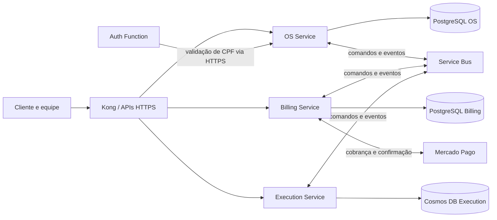

# Base para a entrega acadêmica — Fase 4

Este arquivo é um rascunho técnico. Antes de gerar o PDF final, preencher os
dados reais, substituir os estados planejados pela arquitetura implantada,
adicionar o vídeo e validar o acesso aos links. Não representa submissão.

## Participantes

| Nome | Identificador acadêmico |
| --- | --- |
| A preencher | A preencher |

## Repositórios e vídeo

- [OS Service](https://github.com/JoaoGW/soat-api)
- [Billing Service](https://github.com/JoaoGW/soat-billing-service)
- [Execution Service](https://github.com/JoaoGW/soat-execution-service)
- [Infraestrutura AKS](https://github.com/JoaoGW/soat-aks-infra)
- [Infraestrutura PostgreSQL](https://github.com/JoaoGW/soat-postgres-infra)
- [Auth Function](https://github.com/JoaoGW/soat-auth-function)
- Vídeo: **a preencher após gravação e teste de acesso**.

Billing e Execution são privados na revisão atual. O grupo precisa garantir
acesso aos avaliadores, ou alterar a visibilidade mediante sua decisão.

## Arquitetura prevista

O diagrama descreve a solução planejada; é necessário confirmar o que foi
efetivamente implantado, os canais, identidades, bancos e regras de acesso.

## Estratégia de Saga

Foi escolhida a orquestração pelo OS para manter um registro durável das etapas,
prazos, mensagens e compensações sem permitir leitura direta do banco de outro
serviço. O fluxo planejado abre a OS, registra diagnóstico, gera orçamento,
aguarda a decisão, reserva peças, confirma o pagamento e encaminha o reparo.
Inbox/outbox e identificadores estáveis permitem reentrega sem duplicar efeitos.

Em caso de falha, a compensação considera os efeitos já confirmados: cerca o
trabalho, reembolsa pagamento confirmado quando há prova de não início e libera
a reserva após a confirmação financeira apropriada. Estado financeiro incerto
ou trabalho físico iniciado exige reconciliação; timeout não prova rollback.

## Justificativa da divisão e tecnologias

OS mantém o relacionamento com cliente e veículo, histórico e coordenação;
Billing é a autoridade do orçamento e pagamento; Execution controla catálogo,
estoque e reparo. A separação atribui cada dado a um único serviço e permite
evolução e deploy independentes. PostgreSQL é usado nos domínios relacionais
de OS e Billing; Cosmos DB atende às operações de Execution por filial; Service
Bus desacopla comandos e eventos; Kubernetes é o ambiente previsto de execução.
Mercado Pago atende ao requisito de pagamento e OpenTelemetry à observabilidade.
As decisões precisam ser comparadas ao ambiente efetivamente entregue.

## Roteiro sugerido para vídeo — até 15 minutos

1. Apresentar integrantes e arquitetura implantada, incluindo bancos (2 min).
2. Abrir uma OS e demonstrar diagnóstico, orçamento, pagamento e reparo (4 min).
3. Mostrar a Saga, uma falha, compensação e situação final (3 min).
4. Mostrar um pipeline com testes e deploy efetivo da versão aprovada (3 min).
5. Mostrar traces/monitoramento da mesma jornada e encerrar (2 min).

Os tempos são uma sugestão de ensaio; a gravação final deve demonstrar apenas
o que realmente estiver funcionando e ter acesso testado sem login de avaliador.
