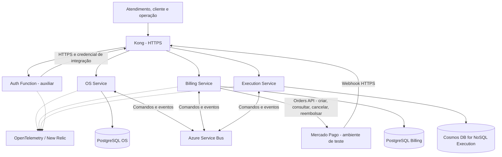

# Plano de implementação da Fase 4 - Sistema Integrado de Oficina

**Data da análise e revisão:** 30/10/2026, America/Sao_Paulo. **Versão:** 2, após revisão de requisitos, escopo e viabilidade de início. **Natureza:** diagnóstico e plano; nenhuma alteração remota, criação de repositório, cobrança, deploy ou mudança de infraestrutura foi executada.

**Conclusão:** a base da Fase 3 pode ser aproveitada, mas ainda é necessário separar os domínios da API em três microsserviços de negócio, isolar dados e permissões, implantar mensageria, implementar a Saga durável e integrar pagamentos reais de teste ao Mercado Pago. A quantidade atual de repositórios de infraestrutura não equivale à quantidade de microsserviços exigida.

O documento da FIAP foi tratado como especificação do trabalho acadêmico. Suas orientações de publicar vídeo, entregar PDF e executar deploy constam como atividades futuras deste plano, sem serem interpretadas como autorização para realizá-las nesta análise.

## 0. Resultado da revisão e escopo da primeira entrega

A revisão não encontrou requisito obrigatório do PDF ausente da matriz. Os 43 IDs são uma decomposição para rastreabilidade, incluindo repetições de CI/CD e entregáveis; não representam 43 funcionalidades diferentes. Os recortes OS/Billing/Execution são exemplos sugeridos no documento, adotados como decisão deste projeto.

O plano anterior misturava exigências da FIAP com evolução operacional. Nesta versão:

- A entrega usa **um ambiente HML no AKS existente**, três Deployments de negócio e três bancos exclusivos. Não exige implantar um segundo ambiente ou migrar os namespaces atuais.
- Cada aplicação começa com API e processamento assíncrono no mesmo processo/Deployment; a durabilidade fica nos bancos. Separar workers em outros Deployments fica para necessidade medida.
- Mantêm-se catálogo, estoque, autenticação e relatórios já existentes. Não se cria produto novo de gestão de filiais: `filialId` é configurado e propagado; CRUD de filiais e autorização de operadores por filial ficam fora da primeira entrega.
- HPA/KEDA, duas réplicas/PDB novos, Private Link Premium, servidores SQL físicos separados, testes extensivos de carga/DR, OTP e migração completa de dados legados não são pré-requisitos acadêmicos.
- Corrigiram-se lacunas de transições da Saga, cancelamento antes de mensagem atrasada, versões locais dos eventos, contrato de aprovação, credenciais, migrations iniciais, conectividade Function/AKS e ordem do cutover.
- Foram retiradas as estimativas numéricas sem validação por execução; o esforço será reestimado após os três spikes.
- O roteiro para começar, com primeiros PRs, arquivos, comandos e configuração, está em [início da implementação](./inicio-implementacao-fase4.md).

| Classificação | O que entra |
|---|---|
| **Obrigatório do PDF** | Três serviços/repos/infraestruturas/bancos próprios; SQL e NoSQL; integração Mercado Pago; REST quando necessário e mensageria; Saga com compensação e justificativa; unitários, BDD completo, 80% por serviço, Sonar/similar no CI; CI/CD independente/Kubernetes; main com PR/checks; observabilidade da Fase 3; código/Docker/manifests/pipelines/documentação/API/cobertura; vídeo <=15 min e PDF do portal |
| **Necessário para a solução escolhida funcionar** | Outbox/inbox, idempotência financeira e de estoque, persistência/retomada da Saga, controle de concorrência, isolamento real de credenciais, webhook validado, dados de contexto via mensagens/API e compensação confirmada |
| **Decisão técnica de partida, não exigência do PDF** | NestJS/Prisma reaproveitados, Service Bus Standard, Cosmos DB for NoSQL, Saga no OS, PostgreSQL em dois bancos lógicos no servidor existente, pagamento antes do reparo, HML existente |
| **Opcional após o aceite mínimo** | Ambiente produtivo novo, novos namespaces, workers separados, HA/autoscaling adicional, rede privada Premium, novo portal/frontend, gestão completa de filiais, OTP, biblioteca/repo compartilhado, migração histórica integral, benchmark/DR completo e dashboards adicionais |

O contexto acadêmico da página 2 também permanece registrado: atividade obrigatória, em princípio em grupo, com peso de 90% na nota das disciplinas da fase. A data limite deve ser conferida no portal; o PDF não a informa.

## 1. Escopo, evidências e limites

Foram lidas as sete páginas do PDF, com conferência visual integral das páginas 2 a 6, que contêm os requisitos. Foram consultados os quatro repositórios remotos, suas árvores completas de `main` e `development`, comparações entre branches, todos os 35 outros ponteiros de branches, PRs abertos e execuções recentes do GitHub Actions. Foram obtidos 308 arquivos de código, testes, configuração, documentação e infraestrutura para inspeção, além das diferenças específicas presentes na `main` de AKS. Arquivos gerados e relatórios antigos não foram tratados como prova de qualidade atual.

A pasta local é o repositório `JoaoGW/FIAP_TechChallenges`; a fonte do diagnóstico são os quatro repositórios remotos indicados pelo solicitante. A cópia local antiga não foi usada como substituta do estado remoto.

Artefato de rastreabilidade: [fontes-auditoria-2026-10-30.json](./fontes-auditoria-2026-10-30.json), com SHAs completos, branches, arquivos consultados e links de workflows. A data de corte identifica um retrato verificável; alterações posteriores exigem nova comparação.

Limites da conclusão:

- Não houve acesso ao Azure, ao state real, ao Key Vault ou à conta do Mercado Pago. O estado vivo dos recursos, saldos, quotas, domínios, secrets e permissões efetivas permanece a confirmar na execução.
- `protected=true` aparece nas branches principais dos quatro repositórios. O detalhamento de branch protection retornou HTTP 403 pela integração; portanto, PR obrigatório, aprovação e checks realmente exigidos ainda precisam ser comprovados.
- Um workflow com resultado `success` pode ter pulado etapas condicionais de apply/deploy. Não foi interpretado como prova de implantação ou disponibilidade atual.
- As últimas atualizações de código consultadas são de setembro/2026; o último CI da API listado é de 16/09/2026. A consulta foi feita em 30/10/2026; nesta revisão os oito SHAs de main/development foram consultados novamente e permanecem iguais.
- Os nomes dos novos repositórios e os caminhos futuros abaixo são propostas, não recursos já criados.

### 1.1 Base exata por repositório

| Repositório | `main` | `development` | Diferença de development em relação à main | Consequência |
|---|---|---|---|---|
| PostgreSQL | `cfe18fc432df` | `6fb8d0b6c9de` | 13 commits à frente; 0 atrás | Infraestrutura funcional está em development; main contém 7 arquivos de estrutura inicial. |
| AKS | `8266fe617a9f` | `72c008ab3812` | 2 à frente; 6 atrás | Branches divergentes: preservar correções operacionais da main e documentação da development. |
| Auth Function | `15eb876b7370` | `4f3df7143e04` | 50 à frente; 0 atrás | Main tem estrutura inicial; autenticação e Terraform estão em development. |
| API | `68241cddd26c` | `4eb05bcc7adb` | 32 à frente; 0 atrás | Proteção de cliente, deploy e observabilidade estão em development; há PR aberto #13 para main. |

Fontes: [comparação PostgreSQL][pg-compare], [comparação AKS][aks-compare], [comparação Auth][auth-compare], [comparação API][api-compare] e [PR #13][api-pr].

Em AKS, a main possui ajustes de CI, diagnóstico de observabilidade e uso da imagem `registry.k8s.io/pause:3.10` no sincronizador de secrets. A development ainda contém a imagem BusyBox anterior. A branch `fix/imagem-sincronizador-observabilidade` tem atualização de README fora da main, já representada na documentação da development. A branch antiga `imp/fase4-autenticacao-cpf` possui oito commits exclusivos de setembro, mas está 68 commits atrás da main; seu nome não significa atendimento à Fase 4 do PDF. Não fazer merge indiscriminado desse trabalho antigo. [Diferenças atuais de AKS][aks-reverse].

## 2. Diagnóstico do que existe

### 2.1 `soat-postgres-infra`

**Aproveitar:** módulo Terraform de PostgreSQL Flexible Server 16, rede privada e DNS recebidos da foundation, separação HML/PROD, TLS obrigatório, backup de sete dias, senha aleatória e URL no Key Vault; CI com fmt, validate, TFLint, Trivy e plano de PR; autenticação Azure por OIDC.

**Lacunas e mudanças necessárias:**

1. Há um banco de aplicação por ambiente (`oficina_hml`/`oficina_prod`), sem separação por domínio. Criar bancos e identidades independentes de OS e Billing; o banco de Execution será NoSQL.
2. A URL entregue à aplicação usa o usuário administrador do PostgreSQL. Criar papéis de runtime e migration distintos e restringir acesso a um único banco.
3. A Function recebe a mesma conexão usada pela API. Retirar essa conexão ao substituir sua consulta SQL por API interna do proprietário de clientes.
4. O servidor atual não configura HA ou geo-backup. Preservar o backup existente; HA adicional, geo-backup e ensaio completo de restore são evoluções opcionais, sem bloquear a primeira entrega.
5. A documentação menciona trabalho futuro de privilégio mínimo e rotação. Verificar sua realização no ambiente; não presumir que a menção no README o implementa.
6. Definir um único proprietário de cada recurso e state durante a extração. Não gerenciar o mesmo banco simultaneamente neste repo e em um repo de serviço.

Fontes: [módulo PostgreSQL][pg-module], [README][pg-readme] e [workflow de deploy][pg-deploy].

### 2.2 `soat-aks-infra`

**Aproveitar:** AKS compartilhado, Azure CNI Overlay, namespaces HML/PROD, Kong, VNet/subnets, Key Vault, OIDC, Workload Identity, Secrets Store CSI, Terraform remoto, New Relic e OpenTelemetry. O compartilhamento do cluster é compatível com serviços independentes, desde que workloads, identidades, bancos, manifestos e deploys sejam independentes.

**Lacunas e mudanças necessárias:**

1. A foundation conhece a API atual e a Function; parametrizar novas identidades por serviço/ambiente, sem copiar grants amplos.
2. Os pipelines da API possuem papel de administrador do cluster no código. Não ampliar esse acesso ao copiar a configuração; preferir escopo limitado nos pipelines novos. A revisão geral dos privilégios antigos é melhoria de segurança, separada da extração.
3. A leitura de secrets está atribuída no nível do Key Vault compartilhado. Separar cofres por serviço ou restringir os escopos a secrets específicos; impedir acesso a credenciais de outro banco.
4. Criar mensageria, suas permissões, DLQs, alertas e contratos de propriedade dos recursos.
5. Prever subnets/DNS/endpoints para o NoSQL, quando privados, e conectividade de runners/Jobs responsáveis pelas migrations.
6. O código atual limita o autoscaling dos nós a 1-2. Recalcular capacidade para três aplicações, workers, Kong, observabilidade e Jobs; HPA não cria capacidade que o node pool não pode fornecer.
7. O webhook de pagamento requer URL HTTPS acessível pelo Mercado Pago em HML. Não é preciso criar exposição pública de PROD para concluir a fase.
8. Planos de PR possuem reduções de escopo por limitações de RBAC. Manter a validação estática completa e acrescentar um plano completo protegido antes do apply, sem apresentar um plano parcial como cobertura de toda a infraestrutura.

Fontes: [foundation][aks-foundation], [ambiente HML][aks-hml], [observabilidade na main][aks-obs] e [CI na main][aks-ci].

### 2.3 `soat-auth-function`

**Aproveitar:** validação de CPF, interface de repositório, caso de uso isolado, JWT de cliente separado do administrativo, issuer/audience/expiração, testes unitários, observabilidade e deploy OIDC.

**Lacuna de isolamento:** `PostgresClienteAuthRepository` executa `SELECT` na tabela `Cliente` da API. O requisito proíbe acessar diretamente o banco de outro serviço, inclusive apenas para leitura. Substituir esse adapter por cliente HTTP de uma API interna do OS Service; o OS continuará proprietário de Cliente e Veículo. Remover `DATABASE_URL`, pool `pg`, permissões e referência ao secret do banco da Function. [Adapter atual][auth-db].

**Qualidade:** o Jest atual não possui limite de cobertura e o CI executa testes sem coleta obrigatória de cobertura. Preservar seus testes e acrescentar os do adapter HTTP modificado. Aplicar nela também cobertura/Sonar é recomendável, mas a evidência mínima por serviço será apresentada separadamente para OS, Billing e Execution, que são os três serviços de negócio escolhidos. [Jest][auth-jest], [CI][auth-ci].

**Decisão de escopo:** manter a Function como dependência serverless herdada da Fase 3. Ela não é contada entre os três serviços de negócio; OS/Billing/Execution terão seus Dockerfiles, bancos e deploys Kubernetes. Não planejar um quarto serviço nem uma migração da Function para Kubernetes sem uma exigência adicional expressa.

### 2.4 `soat-api`

**Aproveitar:** NestJS, TypeScript, domínio e casos de uso separados de adapters, Prisma, migrações, dinheiro em centavos, validações, histórico append-only de status, JWT e autorização por proprietário da OS, testes, Swagger/Postman, Kustomize, Job de migration e telemetria.

**Lacunas funcionais:**

1. `OrdemDeServico` reúne orçamento, aprovação, peças, serviços e execução. O schema tem as relações de todos esses contextos em um único banco. A arquitetura atual é uma aplicação de negócio centralizada. [Modelo][api-schema], [entidade][api-os].
2. Não foram encontrados adapters de mensageria, Saga persistida, outbox/inbox, integração Mercado Pago ou banco NoSQL nas árvores consultadas.
3. Não existe entidade ou ciclo financeiro de pagamento; os status atuais não distinguem aguardando pagamento, pago e reembolsado. O webhook existente é de aprovação de orçamento, não confirmação financeira. [Status][api-status], [webhook atual][api-webhook].
4. `IniciarExecucaoUseCase` baixa as peças antes de validar `os.iniciarExecucao()` e salvar a OS, usando saves separados. Uma falha posterior pode deixar estoque alterado. Na extração, trocar por reserva e consumo atômicos no dono do estoque, com compensação idempotente. Também agregar quantidades repetidas da mesma peça antes de validar disponibilidade. [Caso de uso][api-start].
5. O envio de orçamento salva a OS e depois envia notificação. Falhas entre essas operações podem deixar estado e efeito externo divergentes. Migrar a notificação para tarefa durável com retry e deduplicação. [Envio de orçamento][api-send].
6. A autorização de cliente faz busca direta da OS antes de aprovar orçamento. Após a separação, Billing deverá validar o vínculo por um snapshot confiável de `clienteId`/`filialId`, mantendo os testes de acesso a outra OS. [Controller de cliente][api-client].
7. A documentação de testes ainda contém referência a consulta pública retirada na development; corrigir documentos e coleções com base na nova API.

**Qualidade comprovada e seu alcance:** o log do CI de 16/09/2026 registra 59 suítes/215 testes unitários e 10 suítes/51 testes de integração aprovados. A linha agregada mostra 96,61% de statements, 86,63% de branches, 96,23% de functions e 97,45% de lines. Essa medição cobre domínio e aplicação segundo o Jest atual, incluindo alguns auxiliares de teste, e não equivale a 80% de cada futuro serviço. Não foi encontrado fluxo BDD executável nem SonarQube/similar configurado. [CI e log][api-ci-run], [configuração Jest][api-jest].

**Deploy:** o workflow publica por SHA e possui Jobs de migration e rollout, mas o deploy depende de `build_and_publish`; não depende do resultado do CI separado. Uma falha de testes no mesmo commit não impede por si só a execução desse workflow. Unificar ou encadear explicitamente os gates antes da publicação/deploy. As travas de custo podem pular a aplicação mesmo em uma execução verde. [Workflow][api-deploy].

## 3. Matriz completa dos requisitos do PDF

Legenda: **Lacuna** = não evidenciado na base; **Parcial** = existe algo reaproveitável, mas precisa adaptação/prova; **Entrega** = preparar ao final. A coluna de tarefas aponta para o backlog da seção 14. A numeração de páginas corresponde às páginas físicas do PDF.

| ID | Requisito | Pág. | Estado | Implementação e evidência de aceite | Tarefas |
|---|---|---:|---|---|---|
| R01 | Mínimo de três microsserviços independentes | 2 | Lacuna | OS, Billing e Execution executam separadamente | T08-T10 |
| R02 | Repositório próprio por microsserviço | 2,5 | Lacuna | Três URLs de aplicação; infraestrutura não conta como serviço | T02,T08-T10 |
| R03 | Infraestrutura própria por microsserviço | 2 | Parcial | Manifestos/IaC, identidade, deploy e banco de cada dono; cluster/namespace compartilhados | T03-T06,T11 |
| R04 | Banco próprio por microsserviço | 2-3 | Lacuna | Três bancos e credenciais isoladas | T05,T06 |
| R05 | Pelo menos um banco SQL | 3 | Parcial | PostgreSQL exclusivo de OS e de Billing | T05 |
| R06 | Pelo menos um banco NoSQL | 3 | Lacuna | Cosmos DB for NoSQL exclusivo de Execution | T06 |
| R07 | Nenhum acesso ao banco de outro serviço | 4 | Lacuna | Testes negativos de credenciais/RBAC; Function via API | T05-T07,T25 |
| R08 | Estratégia de REST síncrono quando necessário | 3-4 | Parcial | OpenAPI, autenticação interna, timeout e decisões documentadas | T04,T07-T10 |
| R09 | Mensageria assíncrona e integração desacoplada | 4-5 | Lacuna | Broker real, consumidores e eventos funcionando | T03,T12-T16 |
| R10 | Saga do fluxo transacional da OS | 4 | Lacuna | Estado durável, comandos, respostas e retomada | T13-T16 |
| R11 | Rollback/compensação em falhas de etapas | 4 | Lacuna | Matriz de compensação e testes de falha | T15,T16,T23 |
| R12 | Escolha de Saga documentada e justificada no README | 4 | Lacuna | ADR e README de cada participante | T04,T27 |
| R13 | Integração com Mercado Pago para pagamentos | 3 | Lacuna | Order/QR e pagamento em ambiente de teste real, webhook e consulta | T17-T20 |
| R14 | Testes unitários em todos os microsserviços | 4 | Parcial | Suites locais de cada novo serviço | T21 |
| R15 | Pelo menos um fluxo completo com BDD | 4 | Lacuna | Feature executável com os três serviços e broker | T22 |
| R16 | Cobertura mínima de 80% por serviço | 4 | Parcial | Gates separados e relatórios identificados por SHA | T21,T24 |
| R17 | SonarQube ou similar no CI | 4 | Lacuna | Quality Gate bloqueante por serviço | T24 |
| R18 | CI/CD independente por microsserviço | 4 | Parcial | Cada repo publica e implanta sua própria imagem | T11,T24 |
| R19 | Build em cada pipeline | 4 | Parcial | Job obrigatório por repo e SHA | T24 |
| R20 | Testes automatizados em cada pipeline | 4 | Parcial | Unitários bloqueantes em cada CI; integração/BDD na validação protegida do conjunto | T21,T22,T24 |
| R21 | Verificação de qualidade em cada pipeline | 4 | Parcial | Lint e Sonar/alternativa comprovada | T24 |
| R22 | Deploy automatizado em Kubernetes | 4-5 | Parcial | Três deployments e demonstração de rollout | T11,T24,T28 |
| R23 | Main protegida, com PR obrigatório | 5 | Parcial | Captura/export das regras exigindo PR, sem testar push contra código válido | T02 |
| R24 | Checagens automáticas exigidas para merge | 5 | Parcial | Merge bloqueado com teste/quality gate reprovado | T02,T24 |
| R25 | Reutilizar monitoramento/observabilidade da Fase 3 | 5 | Parcial | New Relic/OTel estendidos aos serviços e mensagens | T26 |
| R26 | Código-fonte por repo | 5 | Parcial | Código completo, instruções e tag da entrega | T08-T10,T27 |
| R27 | Dockerfile por repo de microsserviço | 5 | Parcial | Três imagens executáveis e reproduzíveis | T11 |
| R28 | Manifestos Kubernetes por repo | 5 | Parcial | Bases/overlays e workers de cada dono | T11 |
| R29 | Pipelines versionados por repo | 5 | Parcial | Workflows próprios e links de execução | T24 |
| R30 | Evidências de cobertura no README | 5 | Lacuna | Links/prints de cada serviço, sem média global | T27 |
| R31 | Documentação da arquitetura do serviço | 5 | Parcial | Contexto, dados, contratos, Saga e operação | T27 |
| R32 | Swagger ou collection Postman atualizada | 5 | Parcial | Documentação e exemplos de cada serviço | T27 |
| R33 | Vídeo YouTube/Vimeo, público ou não listado, até 15 min | 5 | Entrega | URL acessível e duração verificada | T29 |
| R34 | Vídeo com fluxo completo da OS entre serviços | 5 | Entrega | Trecho de abertura a conclusão | T28,T29 |
| R35 | Vídeo com Saga e tratamento de falhas | 5 | Entrega | Falha controlada, compensação e retomada | T28,T29 |
| R36 | Vídeo com deploy automatizado e validação de testes | 5 | Entrega | Pipeline de pelo menos um serviço efetivamente aplicado | T28,T29 |
| R37 | Vídeo com monitoramento/rastreamento distribuído | 5 | Entrega | Traces e métricas de uma mesma OS | T26,T29 |
| R38 | PDF do portal com participantes e identificação | 6 | Entrega | Nomes e identificadores acadêmicos conferidos | T30 |
| R39 | PDF com links dos repositórios | 6 | Entrega | Links dos serviços e infraestrutura revisados | T30 |
| R40 | PDF com link do vídeo de até 15 minutos | 6 | Entrega | Link sem pedido de acesso | T30 |
| R41 | PDF com diagrama geral: serviços, bancos, comunicação | 6 | Entrega | Diagrama final coerente com o deploy | T30 |
| R42 | PDF descrevendo orquestração/coreografia escolhida | 6 | Entrega | Estratégia e compensações explicadas | T30 |
| R43 | PDF justificando divisão e tecnologias | 6 | Entrega | Justificativas ligadas ao domínio e à base existente | T30 |

Os três recortes de serviço apresentados no PDF são exemplos sugeridos; adotá-los é uma decisão deste plano. Sua adoção abrange abertura/status/histórico, geração/envio de orçamento, registro/verificação de pagamento, atualização de OS após pagamento, fila operacional, diagnóstico/reparos e comunicação de finalização.

O contexto de múltiplas filiais motiva `filialId`, isolamento operacional e estoque por filial. O PDF não especifica uma plataforma completa de gestão de filiais, um quarto serviço de cadastro, cluster exclusivo por serviço, banco de fornecedor específico, frontend, Kafka obrigatório ou uma certificação de HA. Esses itens não devem virar dependências indevidas da entrega.

## 4. Arquitetura proposta e decisões

### 4.1 Três serviços de negócio

| Serviço / repo proposto | Responsabilidade e fonte da verdade | Banco próprio | Infraestrutura própria |
|---|---|---|---|
| **OS Service** / manter `soat-api`, documentando seu novo escopo | Cliente, veículo, contexto de filial, abertura da OS, estado agregado, histórico, relatórios, autorização de acesso e orquestrador Saga | PostgreSQL `os_hml` | IaC do banco e mensageria próprios, identidade/ServiceAccount, Deployment com API+worker, migrations |
| **Billing Service** / novo `soat-billing-service` | Orçamentos versionados, aprovação/recusa, envio, cobranças, Mercado Pago, pagamentos, reembolsos e conciliação | PostgreSQL `billing_hml` | IaC do banco e mensageria próprios, identidade/ServiceAccount, Deployment com API+worker/webhook, migrations |
| **Execution Service** / novo `soat-execution-service` | Catálogo técnico de serviços e peças, preços de referência, estoque por filial, diagnóstico, reservas, fila e execução/reparo | Azure Cosmos DB **for NoSQL**, `execution_hml` | IaC do banco/container e mensageria próprios, identidade/ServiceAccount, Deployment com API+worker, índices NoSQL |

O nome `soat-api` pode ser mantido para preservar histórico e links. Seu README, imagem, labels e nome lógico de telemetria devem indicar claramente que agora é o OS Service. Renomear o repo não é requisito.

Preços de referência de peças/serviços ficam em Execution para reduzir a fragmentação inicial do catálogo existente. O diagnóstico produz um snapshot versionado de itens e preços em centavos. Billing é autoridade do orçamento aprovado, totais e valores cobrados; alterações no catálogo não alteram um orçamento já emitido. Esta fronteira deve ser registrada em ADR para evitar dois donos do preço aprovado.

Cliente e Veículo ficam inicialmente em OS. Não criar serviço adicional de cadastro apenas para alcançar contagem de microsserviços. Billing e Execution mantêm somente IDs/snapshots necessários; não importam o Prisma Client, repositories ou entidades persistidas do OS.

### 4.2 Plataforma compartilhada e propriedade definida

- `soat-aks-infra` continua dono de cluster, rede, Kong, observabilidade e namespace Kubernetes `hml`. Acrescenta namespace Service Bus e topic compartilhado `soat.domain.events`.
- `soat-postgres-infra` continua dono do servidor PostgreSQL físico HML e banco legado. Acrescentar um módulo **somente de banco**, separado do módulo que cria servidor, e output não sigiloso `server_id`. Não recriar nem transferir o servidor existente.
- Repos OS e Billing são donos das instâncias do módulo de seus bancos novos, em `infra/environments/hml`, com state por serviço; consomem `POSTGRES_SERVER_ID` como identificador de deploy e fixam a revisão do módulo. Cada um possui manifestos, identidade, configuração, fila/subscription utilizada e migrations próprios.
- Execution é dono de seu banco/container Cosmos e fila de comandos. O sistema utiliza **bancos distintos**, sem foreign keys ou schemas de negócio compartilhados entre serviços.
- Bootstrap de usuários SQL é feito dentro da rede privada por Job administrativo controlado. A credencial administrativa não entra nos Deployments; migration e runtime usam credenciais separadas por banco.
- Configuração de plataforma fornece somente IDs/endpoints necessários. Workloads não leem state Terraform de outro serviço e não recebem credenciais ou acesso aos bancos alheios.
- `soat-auth-function` usa REST do OS pela rota de integração protegida no HTTPS do Kong. Não criar repo adicional de contratos ou biblioteca compartilhada no início; schemas versionados ficam nos repos e são verificados por fixtures compatíveis.

Infraestrutura própria significa que cada serviço possui configuração, recursos e ciclo de deploy identificáveis em seu repo. Não exige cluster, servidor físico ou namespace Kubernetes exclusivo. Usar três bancos/configurações com propriedade única evita o custo de mover states existentes ou criar três clusters.

### 4.3 Tecnologias de partida e limites do escopo

Decisão-base: **Service Bus Standard** e **Cosmos DB for NoSQL**, aproveitando Azure. A escolha só muda se T03/T06 demonstrarem impedimento real de custo, disponibilidade ou recurso; nesse caso registrar uma única substituição antes dos adapters definitivos, sem desenvolver duas alternativas.

- HML usa Service Bus Standard com TLS e identidade Azure. Ele não oferece Private Endpoint; Premium/rede privada adicional é opcional e só entra se houver restrição real do ambiente. [Private Link][sb-private].
- Para a primeira implementação, não habilitar sessions nem deduplicação do broker como dependências de correção. A aplicação usa `messageId`, `operationId`, etapa esperada e CAS/inbox para duplicação/concorrência. Sessions e deduplicação do broker podem complementar depois. [Recursos opcionais de sessions][sb-sessions], [deduplicação][sb-duplicates].
- Cosmos é NoSQL documental, apesar da sintaxe de consultas. O spike valida batch, ETag, identidade e limites do container, sem instalar banco em StatefulSet no cluster.
- Reutilizar servidor PostgreSQL HML com dois bancos lógicos e papéis isolados. Servidores físicos novos, HA, múltiplas regiões e novo ambiente PROD ficam fora do mínimo.
- Verificar orçamento/quota e conectividade dos recursos novos antes do apply. Não presumir crédito gratuito disponível nem exigir uma plataforma nacional completa para a apresentação.

### 4.4 Diagrama da solução-alvo



As setas de banco representam acessos exclusivos de seus donos. API, workers e outbox de um mesmo serviço podem compartilhar seu banco; serviços diferentes não compartilham credenciais.

## 5. Dados, regras e migração do domínio

### 5.1 Propriedade e modelo mínimo

| Origem atual | Destino | Mudança necessária |
|---|---|---|
| `Cliente`, `Veiculo` | OS | Preservar IDs, validação, relacionamento e soft delete; consultas externas somente por API autorizada |
| `OrdemDeServico`, `HistoricoStatusOS` | OS | Preservar histórico, acrescentar `filialId`, versão otimista, IDs de orçamento/execução e projeção de status |
| `orcamentoGerado`, `orcamentoAprovado`, `valorTotal`, itens de orçamento | Billing como verdade; OS como projeção | Criar agregado Orçamento com versão e snapshot; remover responsabilidade de cálculo/aprovação da entidade OS |
| `Servico`, `Peca`, estoque | Execution | Documentos de catálogo e saldo por filial; preços de referência e reserva/consumo separados |
| Itens usados no reparo e datas técnicas de execução | Execution | Ordem de execução, diagnóstico, fila, etapas, reservas, consumos e eventos |
| Dados financeiros inexistentes | Billing | Cobrança, tentativa, IDs do provedor, pagamento, reembolso, webhook inbox e reconciliação |
| Estado distribuído inexistente | Cada dono | `Outbox`, `Inbox`; OS também `SagaInstance`, `SagaStep`, deadlines e operações de compensação |

**OS PostgreSQL:** Cliente, Veículo, OrdemDeServico com `filialId`, HistoricoStatusOS, SagaInstance, SagaOperation, Outbox, Inbox e IdempotencyRequest. Filiais vêm de configuração/fixtures na primeira entrega; não é necessária uma entidade ou CRUD de Filial. Foreign keys permanecem apenas dentro desse banco.

**Billing PostgreSQL:** Orcamento, OrcamentoItem, DecisaoOrcamento, Cobranca, TentativaCobranca, Pagamento, Reembolso, WebhookRecebido, Outbox, Inbox e IdempotencyRequest. Unicidade de `externalReference`, `providerOrderId`, `providerPaymentId`, versão do orçamento e chave da operação. Valores em centavos/BRL; conversão decimal exata no adapter externo.

**Execution Cosmos:** documentos tipados de ordem de execução, diagnóstico, fila, catálogo, saldo, reserva, consumo, inbox e outbox. Campos de correlação e versão em todos os agregados pertinentes. Índices por filial, estado da fila, prioridade/data de entrada, OS e operações pendentes; paginação com continuation token.

### 5.2 Transações locais em Execution

Para a primeira entrega, usar um container operacional particionado por `filialId`, com documentos de estoque, reserva, execução, inbox e outbox que participem da mesma operação local. Assim é possível realizar reserva de múltiplas peças da filial, registro da operação, inbox e outbox em um **transactional batch da mesma partição**. Usar ETag/versão para impedir duas reservas sobre o mesmo saldo. O SDK oficial documenta batch transacional com rollback em falha e limite de 100 operações. [SDK Cosmos][cosmos-batch].

Limite inicial: até 20 SKUs distintos por OS. Usar um documento de reserva com os itens e uma alteração de saldo por SKU, mais execução/inbox/outbox; calcular e verificar o total de operações antes de enviar o batch. Validar tamanho/limites efetivos em T06. Retentar conflito de ETag recarregando os saldos, sem reservar parcialmente. Não usar bulk como transação nem prometer atomicidade entre containers ou partições.

`filialId` favorece a transação local de estoque. T06 valida o limite do batch e o consumo básico da partição; benchmark de escala nacional, reparticionamento e arquivamento histórico ficam para evolução. Definir retenção de inbox/outbox superior ao prazo de retry. Não aplicar TTL que apague reservas ou cancele estoque automaticamente.

### 5.3 Status, invariantes e filiais

Separar três dimensões: `statusOS` no OS; `statusFinanceiro` em Billing; `statusExecucao` em Execution. A Saga possui status próprio, sem substituir essas dimensões.

- OS: `RECEBIDA -> EM_DIAGNOSTICO -> AGUARDANDO_APROVACAO -> AGUARDANDO_PAGAMENTO -> NA_FILA -> EM_EXECUCAO -> FINALIZADA -> ENTREGUE`, além de `CANCELAMENTO_PENDENTE` e `CANCELADA`. Falha técnica/reconciliação fica no status da Saga, visível na consulta, sem inventar progresso de negócio. Reserva é subestado da Saga.
- Billing: orçamento rascunho/emitido/aprovado/recusado/expirado/substituído; cobrança criada/pendente/paga/cancelada/expirada; reembolso pendente/concluído/falhou.
- Execution: diagnóstico pendente/em andamento/concluído; reserva ativa/liberada/consumida; fila aguardando/chamada; execução iniciada/finalizada/cancelada.
- Saga: em andamento, aguardando interação, compensando, compensada, concluída e reconciliação necessária.
- Uma OS só avança para fila de reparo com orçamento aprovado, reserva válida e pagamento confirmado conforme a política adotada neste plano.
- Entrega exige execução finalizada e situação financeira válida; Billing publica o fato financeiro e OS decide sua própria transição.
- Pagamento, reserva ou evento repetido não duplica efeito. Um orçamento aprovado tem versão imutável; uma nova versão exige nova decisão e invalida a cobrança anterior de forma segura.
- Estoque nunca fica negativo; liberação não aumenta saldo duas vezes; consumo ocorre uma vez após início autorizado da execução.
- Toda transição de OS grava histórico append-only junto da mudança local. Compensações acrescentam eventos de cancelamento/reversão, sem apagar o que aconteceu.
- Propagar `filialId` desde a abertura; filas e estoque filtram por filial. No HML, usar filiais de fixture e administrador já existente. Clientes continuam restritos às próprias OS. CRUD de filiais, papéis de operador por filial e migração histórica ficam para escopo adicional; não alterar o contrato de identidade herdado sem necessidade.

A cobrança antes do reparo é a regra de negócio escolhida, não uma exigência do PDF. Permite exigir pagamento antes de consumir estoque e iniciar trabalho físico. Mantê-la nos contratos/testes; não criar suporte configurável a múltiplas ordens de pagamento. A Saga termina em `FINALIZADA`, após o reparo; `ENTREGUE` é uma ação posterior do OS que preserva o comportamento existente.

## 6. Contratos de REST e eventos

### 6.1 REST e compatibilidade de partida

Preservar `/ordens-servico`, `/clientes`, `/veiculos`, `/pecas`, `/servicos`, `/auth/login` e as rotas de cliente onde possível. Não adicionar `/v1` a toda a API como condição da extração. APIs novas podem usar os caminhos abaixo; a versão do contrato fica no OpenAPI/schemas.

| Dono | Contrato inicial | Resposta/regra |
|---|---|---|
| OS | `POST /ordens-servico` com `clienteId`, `veiculoId`, `filialId` | `201` após commit local de OS+Saga+outbox; devolve `id`, `codigoAcompanhamento`, `status`, `sagaId` e Location. Repetição da chave retorna a operação original |
| OS | `GET /ordens-servico`, `GET /ordens-servico/:id`, `GET /ordens-servico/:id/historico`, `GET /ordens-servico/:id/saga` | Estado/projeções locais e histórico; dados financeiros/técnicos são atualizados por eventos |
| OS | CRUD de clientes/veículos, `POST /ordens-servico/:id/entregar`, `GET /relatorios/tempo-medio-execucao` | Preservar autorização e contratos já entregues |
| OS | `POST /internal/clientes/validar-cpf` | Rota HTTPS no Kong com bearer de integração exclusivo Function/OS, diferente dos JWTs de cliente/admin; corpo com CPF e resposta ID/ativo mínimos |
| Billing | `GET /orcamentos/:id`; `POST /orcamentos/:id/aprovar`; `POST /orcamentos/:id/recusar` | Corpo de decisão com `versao`; sujeito do JWT deve corresponder ao `clienteId` do snapshot |
| Billing | `GET /cobrancas/por-os/:osId`; `GET /cobrancas/:id` | Consulta autorizada de QR/estado/total; criação da cobrança é comando interno da Saga |
| Billing | `POST /webhooks/mercado-pago` | Validação específica do provedor, inbox durável, resposta rápida |
| Execution | CRUD de `/pecas`, `/servicos`; `GET /execucoes/fila?filialId=...` | Catálogo/saldo próprios e fila ordenada por entrada; ajustes de estoque administrativos |
| Execution | `POST /execucoes/:osId/iniciar-diagnostico`, `/concluir-diagnostico`, `/iniciar`, `/finalizar` | Diagnóstico contém itens/quantidades; servidor consulta seu catálogo, fixa preços e valida estado |
| Todos | `/health` e `/docs`/OpenAPI | Reaproveitar o health atual; separar live/ready apenas quando necessário ao pod |

No Kong, usar prefixos sem conflito: OS recebe `/ordens-servico`, `/clientes`, `/veiculos`, `/cliente/ordens-servico`, `/relatorios` e login; Billing recebe `/orcamentos`, `/cobrancas` e `/webhooks/mercado-pago`; Execution recebe `/pecas`, `/servicos` e `/execucoes`. As antigas ações de aprovação/recusa passam ao contrato de Billing; atualizar a collection em vez de exigir aliases/reescrita complexa. A consulta de cliente no OS devolve `orcamentoId`/versão para a próxima ação. Nenhuma aprovação continua alterando orçamento no banco OS.

As peças/serviços opcionais da abertura antiga, se preservadas por compatibilidade, são **solicitações iniciais**, não preços ou estoque confirmados pelo OS. Execution valida esses IDs no diagnóstico; o OS deixa de consultar repositórios de catálogo.

Definir `Idempotency-Key` em abertura, decisões e ações financeiras; associar chave ao ator+rota+hash do corpo. Mesma chave com corpo diferente retorna `409`. Erros mantêm código estável, mensagem e correlationId: `400` entrada, `401/403` autorização, `404` inexistente, `409` versão/estado e `503` indisponibilidade.

Reaproveitar o adapter de e-mail e links de orçamento em Billing. Para o mínimo, usar aprovação/recusa por POST autenticado já existente; uma nova tela de confirmação ou portal não é necessária. Se links por e-mail forem mantidos, não executar alterações por GET e vincular o token ao orçamento/versão/ação.

### 6.2 Envelope assíncrono obrigatório

```json
{
  "messageId": "uuid-da-mensagem",
  "type": "billing.payment-confirmed.v1",
  "schemaVersion": 1,
  "occurredAt": "2026-10-30T15:00:00Z",
  "producer": "soat-billing-service",
  "aggregateType": "payment",
  "aggregateId": "payment-uuid",
  "aggregateVersion": 2,
  "osId": "os-uuid",
  "sagaId": "saga-uuid",
  "filialId": "filial-uuid",
  "correlationId": "correlation-uuid",
  "causationId": "id-da-mensagem-anterior",
  "operationId": "id-estavel-da-operacao-de-negocio",
  "traceparent": "contexto-w3c",
  "data": { "paymentId": "id-interno", "amountInCents": 15000, "currency": "BRL" }
}
```

JSON ilustrativo: gerar valores reais e validar formatos; `traceparent` é contexto de transporte, não identidade de negócio. `aggregateId` e `aggregateVersion` pertencem ao agregado do produtor; não são uma versão global da OS compartilhada entre os três serviços. Consumidores controlam versão por produtor+agregado e verificam também a operação/etapa esperada. Não enviar CPF, secrets ou connection strings. O contato de notificação é um snapshot mínimo no comando de orçamento, com acesso restrito.

### 6.3 Comandos e fatos mínimos

| Etapa | Comando do OS | Evento/resposta do dono |
|---|---|---|
| Abertura | `execution.request-diagnosis.v1` | `execution.diagnosis-started/completed/failed.v1` |
| Orçamento | `billing.generate-quote.v1` | `billing.quote-issued/failed.v1` |
| Decisão do cliente | REST em Billing, sem comando cruzando banco | `billing.quote-approved/rejected/expired.v1` |
| Reserva | `execution.reserve-parts.v1` | `execution.parts-reserved/reservation-failed.v1` |
| Cobrança | `billing.create-charge.v1` | `billing.charge-created/charge-failed.v1` |
| Pagamento | Webhook/consulta do provedor em Billing | `billing.payment-confirmed/failed/expired.v1` |
| Fila | `execution.enqueue-work.v1` | `execution.work-enqueued/enqueue-failed.v1` |
| Reparos | Ações locais autorizadas em Execution | `execution.work-started/completed/failed.v1` |
| Compensação | `execution.cancel-work/release-parts.v1`; `billing.cancel-charge/refund-payment/cancel-quote.v1` | Resposta de sucesso/falha com mesmo `operationId` |

Cada alternativa da tabela vira um tipo JSON Schema próprio; a notação com `/` apenas agrupa alternativas. Um AsyncAPI formal é opcional. Definir JSON Schemas versionados para cada mensagem e testes de compatibilidade produtor/consumidor. Mudanças aditivas preservam v1; quebra exige v2 e convivência temporária.

### 6.4 Topologia mínima e entrega

- Plataforma: namespace Service Bus HML e topic `soat.domain.events`.
- Billing: fila `billing.commands`. Execution: fila `execution.commands`. OS: subscription `os.saga-events` do topic, filtrada nos fatos relevantes. Não criar `os.commands` ou subscriptions sem consumidor necessário.
- Os três serviços publicam fatos no topic. O OS coordena os comandos; Billing/Execution não precisam consumir eventos um do outro no primeiro fluxo.
- `MessageId=messageId`; entrega **ao menos uma vez**. Sem sessions no MVP, não assumir ordem global/FIFO: confirmar etapa, operação e versão locais antes de aplicar. CAS e inbox continuam necessários mesmo que sessions sejam habilitadas depois.
- Confirmar mensagem após commit local. Para efeito HTTP externo, o commit registra uma tarefa durável; o processamento da tarefa retoma após queda. Não manter lock de broker durante aprovação humana, pagamento ou reparo.
- Erro transitório: retry limitado com backoff; erro de negócio definitivo gera fato de falha, encerrando a etapa. Mensagem inválida vai à DLQ, com motivo e sem loop infinito.
- Reenvio administrativo preserva `operationId`, `causationId` e, quando cabível, `originalMessageId`. A inbox e a operação de negócio impedem repetição do efeito.
- Schema inválido, versão não suportada ou operação de Saga cancelada nunca inicia reparo nem gera cobrança nova.

## 7. Saga orquestrada e compensações

### 7.1 Escolha

Adotar **Saga orquestrada**, com coordenador no OS Service e transporte assíncrono pelo broker. O OS já possui o ciclo e a consulta de status; centralizar a máquina de estados facilita demonstrar, auditar e testar compensações. Billing continua autoridade financeira, Execution autoridade técnica/estoque. O orquestrador envia comandos e reage a fatos; ele não escreve nos bancos dos participantes.

Não é necessário adicionar um quarto repo para o orquestrador. Implementá-lo como worker do OS com persistência própria no banco OS e múltiplas réplicas seguras. Coreografia seria válida pelo PDF, mas aumentaria a distribuição das regras de timeout/cancelamento na primeira migração.

### 7.2 Fluxo feliz completo

1. Atendimento abre OS com cliente, veículo e filial válidos. Na mesma transação: OS/histórico, Saga inicial e outbox de solicitação de diagnóstico.
2. Execution registra diagnóstico e andamento locais; publica início/conclusão com snapshot de itens/preços e versão. OS atualiza sua projeção/histórico.
3. OS solicita orçamento. Billing gera versão imutável, agenda notificação durável e publica emissão. OS passa a aguardar decisão.
4. Cliente aprova a versão correta em Billing, com prova de vínculo com a OS. Billing persiste a decisão e publica o fato. O comando de geração já traz `clienteId`, contato mínimo, `filialId` e snapshot de diagnóstico do OS; não há consulta ao banco OS para autorizar.
5. OS solicita reserva de peças. Execution valida saldo agregado por SKU/filial e reserva atomicamente; publica reserva e vencimento.
6. OS solicita cobrança. Billing cria uma intenção local e chama Mercado Pago por adapter idempotente; armazena order/payment IDs, QR e prazo. OS passa a aguardar pagamento.
7. Webhook é autenticado e persistido por Billing. O worker consulta a order no Mercado Pago, confere referência, valor, moeda e estado canônico. Somente confirmação válida gera pagamento e outbox.
8. OS recebe pagamento, confirma que a Saga e reserva continuam válidas e solicita entrada na fila. Execution registra a entrada uma única vez e confirma.
9. Operador inicia reparo; Execution consome reserva uma vez e publica início. OS registra `EM_EXECUCAO`.
10. Execution finaliza e publica conclusão. OS registra `FINALIZADA` e conclui a Saga. Entregar o veículo é comando posterior do OS, que exige reparo finalizado e situação financeira válida, e registra `ENTREGUE`.

Não processar diagnóstico/reparo automaticamente para fingir interação operacional: os testes podem simular as ações dos operadores via API, enquanto a aplicação mantém os mesmos comandos reais.

### 7.3 Matriz de falhas e ações compensatórias

| Falha/decisão | Reação imediata | Compensação e estado final esperado |
|---|---|---|
| Criação local da OS falha | Rollback SQL local | Nenhum evento de abertura publicado; cliente pode repetir a chave |
| Solicitação/diagnóstico falha definitivamente | Retentar dentro do prazo; registrar motivo | Cancelar tarefa de diagnóstico, marcar OS cancelada sem apagar histórico |
| Geração de orçamento falha definitivamente | Retentar apenas erro transitório | Cancelar orçamento/tarefa aberta e a OS, preservando o motivo; revisão de orçamento como nova jornada fica fora do MVP |
| Envio de e-mail falha | Retry durável de notificação; registrar pendência | Orçamento segue consultável pela API; não duplicar emissão. Sem aprovação até o prazo, cancelar conforme expiração do orçamento |
| Cliente recusa ou aprovação vence | Registrar fato em Billing | Invalidar orçamento/links, cancelar trabalho aberto, liberar qualquer reserva existente e cancelar OS |
| Reserva falha por estoque | Resposta de negócio, sem loop infinito | Não cobrar; batch não deixa reserva parcial; cancelar orçamento/trabalho e OS com motivo de indisponibilidade |
| Criação de cobrança retorna timeout/resultado desconhecido | Manter `CRIACAO_PENDENTE` e mesma chave | Consultar/reconciliar antes de criar outra; nunca presumir que timeout significa ausência de cobrança |
| Cobrança falha definitivamente ou expira sem pagamento | Cancelar/expirar intenção quando aplicável | Liberar reserva e cancelar fila/orçamento; OS cancelada após confirmações |
| Pagamento é negado | Registrar tentativa | Permitir nova tentativa dentro do prazo/política; ao encerrar, cancelar cobrança e liberar reserva |
| Pagamento chega após timeout/cancelamento | Não enfileirar reparo | Confirmar estado real e solicitar reembolso idempotente; manter cancelamento/reconciliação pendente até confirmação |
| Pagamento confirmado e entrada na fila falha definitivamente | Retentar comando com mesma operação | Garantir trabalho cancelado/não iniciado; reembolsar pagamento, liberar reserva e cancelar orçamento/OS |
| API/worker/broker cai após commit local | Outbox reenvia e inbox deduplica | Retomada sem duplicar estoque, cobrança ou histórico |
| Saga cai enquanto compensa | Recarregar etapa persistida | Continuar exatamente as compensações pendentes; não declarar cancelada antes dos ACKs/fatos necessários |
| Cancelamento concorre com início de reparo | Serializar/CAS no Execution | Somente cancelar sem consumo se ainda reversível; responder conflito quando reparo já iniciou e iniciar tratamento operacional |
| Reparo físico falha depois de iniciado | Registrar incidente e impedir entrega | Ações corretivas/retorno ao diagnóstico e eventual ajuste financeiro; não fingir reversão física do reparo executado |
| Reembolso ou liberação falha | Retentar idempotentemente; alertar | `RECONCILIACAO_NECESSARIA`, com motivo, operação pendente e ação manual auditável; não afirmar estorno concluído |
| Mensagem chega fora da ordem/etapa | Validar versão e operação | Ignorar repetição já aplicada ou adiar/reconciliar evento relevante; não retroceder status por evento antigo |

“Rollback distribuído” é implementado por transações locais e compensações de negócio. Cobrança aprovada, comunicação já enviada e trabalho físico não são desfeitos apagando linhas. Cada etapa tem tratamento de falha, inclusive quando a saída correta é uma reconciliação pendente e visível.

### 7.4 Persistência e retomada

- `SagaInstance`: ID, OS/filial, versão do fluxo, etapa/status atual, versão otimista, IDs de quote/reserva/cobrança/execução, deadlines, erro atual, timestamps e indicação de intervenção.
- `SagaOperation`: comando e operação estáveis, etapa, tentativas, resultado e compensação correspondente. Registrar a intenção antes de chamar participante externo.
- Atualização da Saga + histórico/projeção + inbox + próxima outbox na mesma transação PostgreSQL.
- Worker com lease/bloqueio otimista por Saga. Dois pods não devem iniciar a mesma próxima operação. Recuperar leases expirados após queda.
- Timeouts duráveis por `deadlineAt` com varredura e claim concorrente. Defaults de partida: aprovação 24h, cobrança `PT15M`, verificação de etapa técnica a cada 60s e máximo de cinco tentativas transitórias com backoff. Esperas humanas não contam como falha técnica. Os valores são configuração da solução, não requisitos da FIAP.
- Reserva tem deadline operacional inicial de 20min para uma cobrança de 15min. O deadline dispara verificação da Saga, não libera saldo automaticamente. Se pagamento/criação/cancelamento estiver incerto, manter reserva e marcar reconciliação; só liberar por comando confirmado do OS após determinar o resultado financeiro.
- Novas mensagens e compensações verificam a versão da Saga. Uma Saga em cancelamento não volta a executar porque recebeu um pagamento atrasado.
- Registrar `flowVersion=1` e manter compatibilidade com Sagas em andamento durante rollout. Suporte a várias versões de fluxo simultâneas só será implementado quando surgir uma v2 real.

### 7.5 Máquina de estados e cancelamento seguro

| Estado durável da Saga | Entrada aceita / próxima ação | Falha definitiva |
|---|---|---|
| `DIAGNOSTICO_PENDENTE` | Início atualiza projeção; conclusão válida persiste snapshot e emite GenerateQuote | Compensar/cancelar tarefa e OS |
| `ORCAMENTO_PENDENTE` | QuoteIssued -> persistir quoteId/versão, aguardar decisão | Cancelar orçamento/tarefa e OS |
| `AGUARDANDO_APROVACAO` | QuoteApproved da versão vigente -> ReserveParts | Recusa/expiração -> cancelamento |
| `RESERVA_PENDENTE` | PartsReserved -> CreateCharge | Indisponibilidade -> cancelamento sem cobrança |
| `COBRANCA_PENDENTE` | ChargeCreated -> guardar IDs/deadline, aguardar pagamento | Falha conhecida -> cancelar; resultado desconhecido -> reconciliar |
| `AGUARDANDO_PAGAMENTO` | PaymentConfirmed com valor/reserva válidos -> EnqueueWork | Expiração/cancelamento confirmados -> compensar |
| `FILA_PENDENTE` | WorkEnqueued -> NA_FILA | Cancelar trabalho com confirmação antes de reembolsar/liberar |
| `NA_FILA` | WorkStarted -> EM_EXECUCAO | Cancelamento confirmado antes do início -> compensar |
| `EM_EXECUCAO` | WorkCompleted -> OS FINALIZADA e Saga CONCLUIDA | Incidente operacional; sem fingir rollback físico |
| `COMPENSANDO` | Confirmar cancelamento técnico, reversão financeira e liberação aplicáveis | Persistir pendência e encaminhar reconciliação |
| `COMPENSADA` | Somente consulta/auditoria; OS CANCELADA | Pagamento tardio vira reconciliação/reembolso, sem reabrir execução |
| `RECONCILIACAO_NECESSARIA` | Worker/operador confirma resultado e retoma a operação pendente | Não declarar conclusão/cancelamento financeiro sem prova |

`AGUARDANDO_APROVACAO`, `AGUARDANDO_PAGAMENTO` e espera de operador liberam o consumidor. Operações subsequentes são criadas por transação com outbox.

**Barreira contra comando atrasado:** Execution persiste cancelamento por `sagaId/osId` mesmo que a tarefa ainda não exista, criando um registro de impedimento. Qualquer Create/Enqueue/Start posterior para essa Saga é rejeitado. Se o cancelamento concorrer com Start, um CAS decide a única transição permitida: ou cancela antes do trabalho, ou informa que ele já começou. Só a resposta de cancelamento/não início comprovado autoriza a compensação automática pré-reparo. Timeout ou ausência de ACK não prova ausência de trabalho.

Eventos relevantes fora de ordem são persistidos como pendentes, não descartados. Exemplo: PaymentConfirmed pode chegar antes de ChargeCreated; guardar o fato financeiro e reaplicá-lo quando a cobrança/etapa for associada, ou encaminhar ao cancelamento/reembolso se a Saga já estiver encerrando. Controlar isso com status da inbox/fato pendente e reavaliação após transição.

A compensação conserva as flags/resultados de cada operação realizada. Não chama refund quando não houve pagamento nem aumenta estoque que nunca foi reservado. Confirmações repetidas não mudam o resultado. Não reutilizar uma OS cancelada como uma nova Saga no MVP.

## 8. Outbox, inbox e efeitos externos

**SQL:** salvar mudança de negócio e outbox na mesma transação. Dispatcher seleciona pendentes com claim seguro entre réplicas, publica com ID persistido e registra envio. Queda após publicação pode causar reenvio, tratado pela inbox.

**NoSQL:** registrar alteração local, inbox e outbox no batch da mesma partição de filial; dispatcher lê pendências com índice/lease e publica. A prova técnica precisa demonstrar falha intermediária sem perda de evento ou reserva parcial.

**Inbox:** chave única por consumidor + `messageId`; chave de negócio por `operationId` para preservar idempotência mesmo quando chega um novo envelope de retry. Gravar deduplicação e efeitos locais atomicamente; marcar como processada somente após sucesso.

**Efeitos HTTP externos:** Mercado Pago e e-mail não participam da transação local. Registrar operação pendente antes da chamada, usar chave estável quando suportada, persistir resultado e reconciliar incerteza. Para e-mail, usar envio com identificador de notificação e estado separado; duplicidade eventual de entrega deve ser controlada e não alterar a aprovação.

Reter inbox por prazo superior às janelas de replay, com limpeza controlada; reprocessamento histórico deve preservar idempotência de negócio por chaves duráveis. Monitorar idade da outbox e criar um comando operacional auditável de reconciliação, em vez de editar diretamente registros.

## 9. Integração Mercado Pago atualizada

O hyperlink do PDF aponta para uma página antiga de QR dinâmico que, na consulta de 30/10/2026, informa que o conteúdo deixou de existir ou mudou de lugar. A navegação oficial atual de QR Code orienta usar a **Orders API**, incluindo criação, consulta, cancelamento e reembolso. A referência principal deste plano é [processamento de pagamentos QR][mp-processing], e não endpoints antigos de exemplos de outros projetos.

### 9.1 Preparação e adapter

1. Criar/configurar aplicação de teste e contas de teste de vendedor/comprador, seguindo as condições atuais do provedor. Não usar dinheiro ou credenciais de produção na demonstração.
2. Configurar loja e caixa por filial, guardando o mapeamento `filialId -> external_pos_id`. Confirmar requisitos de elegibilidade e o procedimento de compra de teste no spike inicial. [Visão geral oficial][mp-overview].
3. Implementar `PaymentGatewayPort` com `createOrder`, `getOrder`, `cancelOrder`, `refundOrder` e resultado normalizado. O adapter Mercado Pago converte o domínio sem espalhar payloads do provedor pela aplicação.
4. Para QR dinâmico, criar order em `POST https://api.mercadopago.com/v1/orders`, com tipo `qr`, modo `dynamic`, caixa, referência externa única e valores calculados no Billing. A documentação atual exige `X-Idempotency-Key` e devolve `qr_data` para o modo dinâmico. Persistir order ID, transaction/payment ID, chave idempotente e referência externa antes de avançar o estado. [Contrato atual][mp-processing].
5. Gerar QR a partir de `qr_data` para a demonstração; devolver também o payload em endpoint autorizado. A existência de QR ou `status=created` não confirma pagamento.
6. Usar referência externa composta por ID interno e tentativa, sem CPF ou outros dados pessoais. Uma nova tentativa só nasce após resolução da anterior; repetir a chamada usa a mesma chave e corpo.
7. Consultar em `GET /v1/orders/{order_id}`. Cancelar em `POST /v1/orders/{order_id}/cancel`, somente enquanto a order estiver `created`, com chave idempotente. Reembolsar em `POST /v1/orders/{order_id}/refund`, com chave idempotente, corpo vazio para devolução total e order `processed`. A integração QR consultada permite reembolso total; não pressupor suporte a estorno parcial nesse adapter. [Cancelamento canônico][mp-cancel], [reembolso canônico][mp-refund].

A página de guia consultada contém exemplos de cancelamento/reembolso que divergem de seu texto e da referência de API: aparecem um PUT e o caminho plural `/refunds`. O contrato proposto acima segue as páginas canônicas de referência. T17 deve validar esses contratos com credenciais de teste e registrar a evidência; não copiar o exemplo divergente sem teste. A referência também diferencia reembolso já feito, reembolso em progresso, operação temporariamente não habilitada e saldo insuficiente; mapear cada caso para reconciliação, retry ou intervenção, sem criar nova operação financeira às cegas.

### 9.2 Webhook e reconciliação

- Publicar rota HTTPS do Billing no Kong, configurada para o tema `order` da integração escolhida.
- Validar `x-signature`, `x-request-id`, parâmetros de identificação e assinatura HMAC conforme a documentação atual; comparação segura e política de replay/timestamp coerente com a entrega do provedor. Não comparar apenas o corpo com um secret ou reaproveitar `WEBHOOK_SECRET` da aprovação de orçamento. [Notificações oficiais][mp-notifications].
- Persistir a notificação autenticada em inbox durável e responder sucesso rapidamente. Se não conseguir persistir, responder falha apropriada para permitir retry; não responder sucesso descartando o evento.
- O worker consulta a order no provedor por ID conhecido/validado; não faz fetch de uma URL arbitrária recebida no webhook.
- Verificar aplicação/conta/ambiente, referência externa, moeda, montante e estado da order/transação. Para QR/Orders na documentação consultada: `created` corresponde a pendente; order `processed` e pagamento `processed`/`accredited` comprovam pagamento; `expired` e `canceled` impedem avanço; `refunded` representa devolução total confirmada. Falhas/recusas de tentativa devem ser modeladas conforme a resposta efetiva, sem inventar um status externo. Não copiar o termo `approved` de uma API antiga. [Estados atuais de QR/Orders][mp-status].
- Tratar notificações duplicadas, fora de ordem e retries. Uma transação financeira deve produzir um único registro de pagamento e uma única operação de avanço da Saga.
- Implementar varredura de cobranças pendentes/desconhecidas. Se o timeout da criação não deixou order ID, repetir com a mesma chave quando permitido e aproveitar webhook autenticado para recuperar o ID e conferir `external_reference`. Não assumir uma API de busca por referência que não foi verificada. Se a recuperação automática não resolver, registrar reconciliação necessária e impedir nova tentativa com chave diferente/cobrança duplicada.
- Webhook pode chegar antes de o resultado da criação ser gravado. Persisti-lo, consultar a order validada no provedor e associar pela referência interna; ausência momentânea do ID no banco não significa evento descartável.
- Persistir reembolso como operação própria; timeout significa resultado desconhecido. Consultar/repetir idempotentemente e só emitir confirmação após o provedor confirmar.
- A documentação consultada limita a consulta ordinária a orders recentes (menos de três meses) e o reembolso via API a uma janela de até 180 dias. Registrar os dados financeiros necessários localmente e tratar consultas antigas/prazos excedidos por procedimento operacional; não depender de polling eterno como arquivo histórico. [Guia de operações][mp-processing].
- Restringir dados retidos e logs: nunca Access Token, secret HMAC, CPF, dados de cartão ou QR íntegro em logs de telemetria.

### 9.3 Evidência real versus testes automatizados

BDD e CI usam um stub HTTP determinístico do provedor para sucesso, rejeição, timeout, duplicação e reembolso. Esse stub só substitui a fronteira externa; OS, Billing, Execution, broker e bancos são reais na suíte distribuída. Além disso, executar e registrar uma integração ponta a ponta com contas/QR de teste reais do Mercado Pago. Mock isolado não comprova o requisito de integração com Mercado Pago.

## 10. Infraestrutura, segurança e entrega independente

### 10.1 Estrutura de cada repo de serviço

```text
src/domain/
src/application/
src/infrastructure/{database,messaging,observability,external}/
src/interfaces/{http,messaging}/
test/{unit,integration,contract}/
features/                       # onde houver responsabilidade BDD
infra/{modules,environments/hml}/
deploy/kustomize/{base,overlays/hml}/
scripts/
.github/workflows/{ci,deploy}.yml
Dockerfile
README.md
docs/{architecture,contracts,runbooks}/
```

Ajustar a organização atual sem reescrever código/testes úteis. Primeiro: uma imagem e um Deployment por serviço, com API e loops assíncronos no mesmo processo e encerramento coordenado. Separar worker em Deployment próprio é evolução opcional. Preservar arquivos PROD herdados quando existirem, sem exigir criação/aplicação de PROD nos novos repos.

No repo OS, manter os manifests legados e criar o overlay novo em `deploy/fase4/kustomize/overlays/hml`, com base em `deploy/fase4/kustomize/base`. Seu script `deploy-fase4.sh` espera `deployment/soat-os-service` e seu Job de migration, sem aplicar os manifests antigos de `soat-api`. Os repos novos usam `deploy/kustomize` normalmente. As três imagens seguem o mesmo padrão de promoção por SHA, independentemente do nome do workload.

### 10.2 Isolamento efetivo

- Manter namespace `hml`. Os novos workloads/Services/ServiceAccounts serão `soat-os-service`, `soat-billing-service` e `soat-execution-service`; OS continua no repo/imagem de `soat-api`. O Deployment/Service `soat-api` legado permanece intacto durante os testes privados. Criar a identidade/subject do OS novo em vez de reutilizar sua credencial administrativa antiga; trocar a rota pública apenas em T25.
- ServiceAccount e Workload Identity por serviço HML; credenciais de CI diferentes das de runtime. Workloads não recebem permissões de deploy e não montam secrets do banco de outro serviço. Preservar os recursos antigos até o cutover.
- Usuário PostgreSQL de runtime sem superuser/DDL e sem grants para outro banco. Migration usa credencial separada em Job restrito; revogar a URL administrativa do runtime.
- Para comprovar isolamento SQL em servidor físico compartilhado: remover grants públicos inadequados, impedir CONNECT no outro banco, limitar ownership e testar com as credenciais reais de runtime. Banco/schema ou prefixo de tabela apenas nominal não basta.
- Reutilizar o servidor SQL físico HML com bancos lógicos OS/Billing e permissões isoladas. Eles compartilham disponibilidade/manutenção; isso será documentado, sem criar servidores adicionais como condição de aceite.
- Cosmos com permissão de dados restrita ao banco/container Execution. Billing não recebe chave ou papel Cosmos; OS não recebe segredo de Billing.
- Mensageria com grants Send/Listen somente nas entidades necessárias; identidades sem capacidade de excluir namespace ou ler filas não relacionadas.
- Preservar a rede privada do PostgreSQL e proteger recursos novos por identidade/segregação de secrets. NetworkPolicies completas e Private Link adicional são melhorias opcionais; não redesenhar toda a rede como pré-requisito da refatoração.
- Não tornar bancos públicos para que o GitHub runner execute migrations. Reutilizar Job no cluster ou runner conectado à rede; dados sensíveis ficam fora de artifacts de CI.
- Function -> OS usa HTTPS do Kong e bearer de integração aleatório de pelo menos 32 bytes, no Key Vault, acessível apenas à Function e ao OS. A rota não aceita JWT de cliente/admin, não registra CPF/token e tem resposta mínima. A Function está fora do AKS; não apontar para DNS `*.svc.cluster.local` nem presumir roteamento do Service CIDR. Azure CNI Overlay requer uma camada de exposição para acesso externo ao workload. [Rede Overlay oficial][aks-overlay]. Essa opção evita novo balanceador privado ou registro de aplicação Entra; as Workload Identities continuam autenticando acesso aos recursos Azure. Para os clientes, manter `iss=soat-auth-function`, `aud=soat-api`, `sub=clienteId` e validação HS256/role nos três serviços. `soat-api` fica documentado como audience lógico da plataforma nesta versão, evitando migração de tokens. Os três validadores recebem somente o secret de verificação necessário; nunca credenciais SQL alheias. JWT administrativo/login permanecem separados, sem novo sistema de usuários/papéis.
- A autenticação somente por CPF foi herdada da Fase 3. Qualquer reforço de identidade, como OTP, é evolução de segurança a priorizar conforme o uso real, não um requisito inventado para o mínimo da Fase 4.

### 10.3 Kubernetes e runtime

- Dockerfile multi-stage por serviço, instalação reproduzível, execução sem root e imagem identificada por SHA/digest. Não usar tag `latest`.
- Atualizar runtime para uma linha suportada, preferencialmente Node.js 24 após testes de compatibilidade. O calendário oficial encerrou Node.js 20 em 30/04/2026, enquanto a base ainda utiliza 20. Validar separadamente suporte do runtime da Azure Function antes de atualizá-la. [Calendário Node.js][node-schedule].
- Requests/limits e readiness/liveness/startup adequados. Readiness dos workers expressa capacidade de consumo; liveness não deve reiniciar todos os pods por uma indisponibilidade do Mercado Pago.
- Graceful shutdown: parar novas mensagens, concluir/abandonar as em processamento, liberar locks e fazer flush de telemetria com tempo limitado.
- Começar com uma réplica por serviço em HML e concorrência limitada dos loops. Reservar conexões SQL/RU e tratar 429 no Cosmos. Preservar HPA/PDB herdados em PROD sem estender autoscaling/KEDA como requisito desta entrega.
- Declarar a limitação de disponibilidade de HML e demonstrar retomada após reinício. Duas réplicas, novo PDB, espalhamento entre nós e nova configuração produtiva são opcionais.
- Migrations SQL aditivas antes do rollout; mudanças destrutivas só após cutover e retenção. Atualizações NoSQL de documentos/índices também devem ser versionadas.
- Rollback de imagem não desfaz automaticamente migration ou pagamento. Manter schema compatível com versão anterior e usar plano de avanço corretivo/reconciliação.
- Expor no Kong apenas APIs necessárias; não expor interfaces administrativas de broker/banco. TLS e endpoint público específico para webhook; medir dependências de domínio/certificado logo no início.

### 10.4 CI/CD e gates

Pipeline independente de cada serviço, com dependência explícita entre os jobs. `development` publica/implanta HML após gates; `main` continua exigindo PR/checks. Não criar deploy PROD nos repos novos nem permitir que a promoção final aplique automaticamente os overlays antigos em PROD:

1. Checkout do SHA, instalação com lockfile e versão de Node definida.
2. Lint, typecheck, build e validação dos schemas/migrations.
3. Testes unitários e cobertura, com limite de pelo menos 80% para statements, branches, functions e lines por serviço como política proposta.
4. Testes de contrato de REST/eventos e integração local disponível. A validação distribuída real usa HML protegido e versões fixadas, sem tornar todo PR dependente de credenciais SaaS. Nenhum teste pulado conta como comprovação de integração.
5. SonarQube ou SonarQube Cloud com projeto por serviço, importando LCOV e **aguardando Quality Gate**. Falha ou indisponibilidade do gate não libera deploy silenciosamente.
6. Renderizar Kustomize HML e preservar validação PROD já existente; validar IaC com fmt/validate/lint/scanner.
7. Somente após esses gates: construir/publicar imagem por SHA/digest; anexar metadados de build. Verificações de dependências e imagem complementam o gate, sem reaproveitar relatórios antigos como evidência atual.
8. Promover HML automaticamente conforme regras do Environment, executar migration restrita, aplicar manifestos e aguardar rollout.
9. Smoke test de API e round trip assíncrono seguro; comprovar versão da imagem implantada. Se o gate de custo bloquear a ação, registrar “deploy não executado”, não “deploy validado”.
10. Antes do aceite final, registrar BDD/integração real em HML para a combinação exata das três imagens. PROD não é necessário ao PDF; se usado posteriormente, promover a mesma imagem aprovada.

Um workflow unificado com `needs` é a solução mais simples; um encadeamento entre workflows também é válido se verificar conclusão bem-sucedida e igualdade do SHA. Deploy manual não pode ignorar esses gates. Configurar `concurrency` por serviço/ambiente e evitar que um deploy antigo substitua um novo.

Proteção mínima de `main`: PR obrigatório e checks de build/testes/qualidade exigidos. Aprovação adicional, conversas resolvidas e restrições de bypass seguem a política do grupo, sem inventar uma regra acadêmica. Verificar as configurações nos três repos de serviço; `protected=true` sozinho não comprova o conteúdo.

## 11. Estratégia de testes e aceite técnico

### 11.1 Cobertura e camadas

- Unitários por serviço: invariantes, autorização, estados, cálculo em centavos, mapeamento de pagamento e handlers de compensação.
- Medir código de produção relevante, incluindo adapters/consumidores/handlers críticos. Excluir arquivos gerados, declarações e bootstrap sem lógica com justificativa; excluir fakes/helpers de teste da porcentagem. Não obter 80% apenas selecionando um pequeno subconjunto de domínio.
- Integração SQL: constraints, atomicidade de negócio+inbox+outbox, versionamento e concorrência; banco real e migrations aplicadas.
- Integração Cosmos: batch na mesma partição, ETag, rollback de reserva, índices, deduplicação e limites do batch. Usar um ambiente de teste compatível se o emulador não suportar o recurso exato.
- Mensageria: contrato, confirmação após commit, perda de lock, reentrega, fila sem consumidor e DLQ.
- Mercado Pago: validação de assinatura, notificações legítimas/duplicadas/forjadas, leitura canônica, montantes, timeout, consulta e reembolso.
- Contratos: produtor/consumidor validam a mesma versão; CI detecta retirada/mudança de campo obrigatório antes de publicar.
- Separar resultados por repo e SHA; publicar LCOV/HTML/summary e links no README. Testes distribuídos não substituem unitários nem permitem uma cobertura média entre serviços.

### 11.2 BDD executável mínimo

Usar Cucumber com Gherkin em português ou equivalente BDD executável, em um pipeline coordenado. Pode residir no repo OS como consumidor do fluxo; declarar imagens/SHAs dos outros serviços em um manifesto de integração. Isso não retira a independência dos seus pipelines.

```gherkin
# language: pt
Funcionalidade: Jornada distribuída da ordem de serviço
  Cenário: Aprovação, pagamento e conclusão de uma OS
    Dado que existe cliente e veículo ativos na filial A
    E que há peças disponíveis e um serviço no catálogo
    Quando o atendimento abre uma ordem de serviço
    E o operador conclui o diagnóstico
    E o cliente aprova a versão emitida do orçamento
    E o provedor confirma o pagamento da cobrança correspondente
    E a operação inicia e finaliza o reparo
    E o atendimento entrega o veículo
    Então a OS deve estar ENTREGUE com histórico íntegro
    E deve existir um único pagamento para a cobrança
    E o estoque deve ter sido consumido uma única vez
    E a Saga deve estar concluída
    E os três serviços devem registrar a correlação do fluxo

  Cenário: Falha de entrada na fila após pagamento
    Dado que uma OS aprovada possui reserva e pagamento confirmado
    Quando a entrada na fila falha definitivamente antes do reparo
    Então a Saga deve solicitar reembolso e liberar a reserva
    E não deve haver trabalho iniciado
    E a OS só deve ser cancelada após confirmação das compensações
```

Steps chamam APIs/mensagens reais da aplicação e verificam convergência com polling limitado, sem sleeps arbitrários nem escrita cruzada nos bancos. Cada cenário tem dados e IDs próprios; limpeza usa o dono do dado. O stub fica apenas na fronteira Mercado Pago. A integração real de teste é evidência adicional separada.

### 11.3 Casos de integridade da solução escolhida

| Caso | Verificação de aceite |
|---|---|
| Repetir abertura com mesma chave | Uma OS, uma Saga e mesmo resultado |
| Publicar evento duas vezes | Um efeito, um registro de histórico e uma próxima operação |
| Mesmo SKU repetido no orçamento | Quantidade agregada validada; sem reserva acima do saldo |
| Duas OS disputam estoque | Só reservas compatíveis com o saldo são confirmadas |
| Queda após commit, antes da publicação | Outbox publica após retomada |
| Queda após publicação, antes de marcar enviada | Reenvio sem duplicação de efeito |
| Queda após efeito, antes do ACK | Inbox impede efeito repetido |
| Reiniciar orquestrador no meio da Saga | Retoma etapa pendente com IDs iguais |
| Broker indisponível | Estado local não se perde; outbox cresce e drena na recuperação |
| Webhook duplicado/fora de ordem | Não duplica pagamento nem retrocede estado |
| Timeout na criação da cobrança | Consulta/reconciliação evita segunda cobrança |
| Pagamento após cancelamento | Não inicia reparo; reembolso/reconciliação visível |
| Falha após pagamento antes da fila | Compensação financeira e liberação de estoque |
| Falha do reembolso | Estado pendente e alerta; nova tentativa idempotente |
| Timeout de aprovação/pagamento | Cancelamentos e liberações conforme matriz |
| Evento desconhecido/inválido | DLQ/erro auditável sem loop ilimitado |
| Cancelar antes de Enqueue/Start atrasado; cancelar concorre com início | Registro de cancelamento impede trabalho posterior; CAS resolve a corrida |
| Credenciais de A acessam banco de B | Acesso negado em teste de ambiente |
| Cliente acessa OS de outro cliente; fila de outra filial | Acesso do cliente negado; filtro de fila/estoque correto, sem exigir novo RBAC de operadores |
| Teste ou Sonar falha | Merge/deploy bloqueados para o mesmo SHA |

### 11.4 O que não bloqueia a primeira entrega

O aceite exige testes de retomada da Saga, reentrega, concorrência de estoque e compensações da seção 11.3. Benchmark nacional, metas inventadas de throughput, recuperação de desastre multibanco e medição formal de RPO/RTO ficam fora do mínimo.

Preservar os backups atuais e criar backup antes de qualquer migração de dados reais. Se esses dados precisarem ser preservados, ensaiar restore e reconciliar antes do cutover; essa exigência é condicional à migração, não um novo projeto obrigatório de DR.

## 12. Observabilidade e operação

Estender **OpenTelemetry/New Relic existentes**, preservando a escolha da Fase 3. Não implantar Prometheus/Grafana apenas para cumprir uma ferramenta que o PDF não exige.

- Services distintos: OS, Billing, Execution e Auth; atributos de ambiente/versão e propagação W3C `traceparent`/`tracestate` por HTTP e headers do broker.
- Instrumentar produtor/consumidor, outbox, handlers da Saga, banco e adapter Mercado Pago. Criar spans de processamento e links corretos na publicação atrasada/reentrega.
- `correlationId`, `sagaId`, `osId`, `operationId` e `filialId` em logs/traces apropriados. Não usar IDs de OS/Saga como labels de métricas de alta cardinalidade.
- Sagas de horas/dias não precisam manter um único span aberto. Criar spans por etapa e relacionar traces de aprovações/webhooks posteriores por IDs e links; um webhook externo não necessariamente preserva o trace original.
- Dashboard mínimo: serviços/versões, erros e duração de requisições/etapas, status de Saga/compensação e pendências de fila/outbox. Métricas adicionais de capacidade/estoque e painéis especializados ficam para necessidade medida.
- Registrar pendências de Saga/DLQ/reembolso de forma visível e incluir um procedimento de retry/reconciliação. Configuração de central de alertas ou escala de plantão não é requisito para a demonstração.
- Runbook mínimo: identificar Saga/operationId, consultar a pendência, retentar a operação idempotente e confirmar o resultado; incluir rollback de imagem compatível. Não construir console administrativo novo para isso.
- Demonstrar no vídeo uma OS rastreável entre os três serviços e uma compensação, sem expor dados pessoais ou secrets.

## 13. Migração incremental e cutover

### 13.1 Bases e primeiros PRs

1. Usar os SHAs da seção 1.1: OS/Auth/PostgreSQL partem da development; AKS parte da main e incorpora somente a documentação necessária da development. Nesta revisão, as referências principais continuam iguais.
2. Criar branches de trabalho a partir dessas bases; não é necessário promover todo o legado para main antes do primeiro commit da Fase 4. Revisar o PR #13 e preparar a promoção final quando o conjunto estiver validado.
3. Antes de merges que disparem workflows, conferir os Environments/travas para evitar apply produtivo involuntário.
4. Preservar evidência da Fase 3 e seu histórico de migrations; não misturar branches antigas chamadas fase4 com o requisito atual.

### 13.2 Bancos novos e migrations

1. Criar `os_hml`, `billing_hml` e `execution_hml` sem apagar o banco legado.
2. Para OS, criar schema/migrations iniciais em diretório novo, por exemplo `prisma/os/schema.prisma` com `prisma/os/migrations`. Ajustar generate/migrate e testes para esse caminho. Não executar as migrations históricas do monólito no novo banco OS: elas recriariam tabelas de Billing/Execution.
3. Billing recebe seu schema/migrations novos e próprios. Execution recebe container/índices e versionamento de documentos. Não reescrever uma migration que já foi aplicada ao banco antigo.
4. Reaproveitar em OS as constraints/trigger de histórico append-only que pertencem ao seu domínio. Não copiar foreign keys para peças/serviços de outro serviço.
5. A primeira validação usa dados sintéticos novos por APIs/fixtures. O legado fica preservado para consulta/demonstração anterior; migração histórica integral só entra se houver decisão de preservar dados reais na solução nova.

### 13.3 Preservação das funções atuais

| Função atual | Destino e aceite de regressão |
|---|---|
| Login administrativo, CPF/JWT de cliente e acesso apenas à própria OS | Login permanece em OS, Function usa HTTP; os três serviços validam tokens adequados e vínculo do cliente |
| CRUD cliente/veículo, validações/soft delete | OS, com os mesmos casos e testes reaproveitados |
| Peças/serviços, dinheiro em centavos, estoque | Execution, com referências/snapshots no orçamento Billing; sem leitura SQL cruzada |
| Listagem operacional/paginação da OS | OS, baseada em projeções locais; preservar status existentes e acrescentar os novos na prioridade documentada |
| Diagnóstico/reparo/fila | Execution; fila de execução ordenada por entrada/filial; operadores não contornam a autorização da Saga |
| `GET /relatorios/tempo-medio-execucao` | OS mantém `mediaEmMinutos`, `totalOSConsideradas` e métricas por etapa. Eventos de Execution incluem `startedAt/completedAt`; OS persiste as datas/projeções e calcula localmente |
| Histórico de status e consulta de cliente | OS; histórico append-only e fatos suficientes para reconstituir as etapas |
| Orçamento, envio e decisão do cliente | Billing, reutilizando adapter existente; versão/total/cliente congelados no snapshot |
| Swagger, Postman e provas já existentes | Atualizar o dono das rotas e variáveis mantendo exemplos executáveis |

Não criar um novo serviço de relatórios nem fazer joins entre os bancos para preservar esses endpoints.

### 13.4 Cutover de HML e dados reais condicionais

1. Somente depois de fluxo financeiro, BDD e resiliência aprovados, apontar rotas HML para os novos donos e revisar prioridade dos caminhos no Kong.
2. Mudar a Function para HTTP e retirar SQL/grants. Desativar escritores antigos de orçamento/estoque/execução que ainda possam receber tráfego.
3. Expor consultas novas com seu estado consistente eventual documentado; repetir a suíte de autorização/CRUD/histórico/relatórios.
4. A entrega pode usar dados de demonstração novos, com os três serviços independentes. Não é necessário importar todas as OS da fase anterior para atender ao PDF.
5. Se a preservação de dados reais for necessária: abrir tarefa condicional de export/import com dono do dado, backup, janela de escrita suspensa, IDs/histórico/totais reconciliados e sem recriar cobranças. Validar antes da troca de tráfego.
6. Remoção definitiva de banco legado/secrets e transferência de states existentes ficam fora do caminho normal. O desenho com bancos novos evita essa transferência; se ela for inevitável, exigir plano comprovando ausência de destruição/recriação.

Rollback de tráfego não reativa o monólito como segundo escritor das jornadas novas e não repete cobranças.

## 14. Backlog de implementação com dependências e critérios

Prioridades: **P0** fundação/risco de integridade; **P1** implementação obrigatória; **P2** consolidação e entrega. P2 não significa opcional quando ligado à matriz do PDF. Os responsáveis são papéis propostos para o grupo, não pessoas já designadas.

| Tarefa | Pri. | Dono / repos | Depende de | Trabalho e critério de pronto |
|---|---|---|---|---|
| T01 - Fixar baseline e reconciliar branches | P0 | Plataforma + todos os 4 atuais | - | SHAs revalidados, correções de AKS preservadas, PRs revisados e baseline documentado; sem regressão/produção involuntária |
| T02 - Criar repos de serviços e proteção | P0 | Grupo / GitHub | T01 | Billing/Execution criados; main com PR/checks obrigatórios nos 3; prova das regras que hoje não foi possível ler |
| T03 - Spike e IaC da mensageria | P0 | Plataforma / AKS | T01 | Standard/TLS/identidade, topic, duas filas, subscription OS e DLQ validados; mensagem sobrevive à queda; sem sessions obrigatórias |
| T04 - ADRs e contratos v1 | P0 | Domínio + todos os serviços | T01 | Fronteiras, status, pagamento antes do reparo, Saga e envelopes aprovados em repo; OpenAPI e JSON Schemas validados, sem exigir AsyncAPI formal |
| T05 - Bancos SQL e privilégios | P0 | Dados / PostgreSQL + OS/Billing | T02,T04 | DBs isolados, runtime/migration separados, grants restritos, backup e teste de acesso cruzado negado |
| T06 - Spike e banco NoSQL | P0 | Execution + Plataforma | T02,T04 | Cosmos, partição/índices, batch+ETag+outbox/inbox testados; limites/custos e conectividade documentados |
| T07 - Desacoplar Auth do SQL alheio | P0 | Auth + OS | T04,T08,T17 (HTTPS) | Adapter HTTP pelo Kong HTTPS, credencial exclusiva Function/OS, testes de CPF ativo/inativo/erro; sem DATABASE_URL/grants do banco OS |
| T08 - Extrair OS Service | P1 | OS / soat-api | T04,T05 | Cliente/veículo/OS/histórico/relatórios/autorização próprios, filialId configurado; migrations novas; sem catálogo/baixa/cálculo financeiro local |
| T09 - Extrair Billing Service | P1 | Billing | T04,T05 | Orçamento versionado, decisão do cliente, total em centavos, notificações duráveis e dados próprios; testes preservados/adaptados |
| T10 - Extrair Execution Service | P1 | Execution | T04,T06 | Catálogo/estoque/diagnóstico/fila/reparo próprios e adapter NoSQL; isolamento por filial |
| T11 - Container e manifestos por serviço | P1 | Cada serviço | T02 + esqueleto do próprio serviço | Uma imagem/Deployment por serviço em HML, API+loops, probes/recursos/identidades e migration quando SQL; sem esperar a extração dos outros |
| T12 - Outbox/inbox e contratos | P0 | Cada serviço | T03 + banco/esqueleto do próprio serviço | Commit+outbox e inbox+efeito atômicos por serviço, em paralelo; IDs, retry/DLQ e reentrega testados |
| T13 - Orquestrador durável e timers | P1 | OS | T04,T08,T12 | Estado/versão/leases/deadlines persistidos; reinício e concorrência sem duplicar próxima etapa |
| T14 - Integrar fluxo até orçamento | P1 | OS + Billing + Execution | T09,T10,T13 | Abertura -> diagnóstico -> orçamento -> aprovação/recusa convergem por eventos, sem consulta de DB cruzada |
| T15 - Reserva, cancelamento e compensações iniciais | P0 | Execution + OS + Billing | T10,T12-T14 | Estoque concorrente, expiração/recusa e liberação idempotentes; estados e ACKs persistidos |
| T16 - Fluxo de fila, execução e conclusão | P1 | Execution + OS | T14,T15,T19 | Pagamento confirmado autoriza fila; consumo único, início/finalização; Saga conclui em FINALIZADA e entrega posterior permanece no OS |
| T17 - Spike Mercado Pago real de teste | P0 | Billing + responsável pela conta | T04 | Aplicação/contas/loja/caixa/HTTPS e compra teste confirmados; API vigente e elegibilidade registradas, sem valor real |
| T18 - Cobrança e QR no adapter | P1 | Billing | T09,T12,T17 | Criação idempotente com Orders API, QR, IDs persistidos, valor/ref/ambiente corretos; timeout reconciliável |
| T19 - Webhook e conciliação | P0 | Billing | T18 | HMAC, inbox, consulta canônica, dedupe/ordenação e polling de pendências; pagamento confirmado uma única vez |
| T20 - Compensação financeira completa | P0 | Billing + OS + Execution | T15,T16,T19 | Cancelamento/reembolso, pagamento tardio e falha pós-pagamento testados; pendências nunca escondidas como sucesso |
| T21 - Suites e cobertura por serviço | P1 | Cada serviço | T08-T10, incremental | Unitários/integração com >=80% no escopo justificado; adapter/consumidor críticos cobertos; relatórios por SHA |
| T22 - BDD do fluxo distribuído | P1 | Qualidade + todos | T16,T20,T21 | Gherkin executável com 3 serviços/bancos/broker; fluxo feliz e uma compensação completos |
| T23 - Matriz de resiliência e concorrência | P1 | Qualidade + todos | T12,T13,T20 | Casos da seção 11.3 aprovados, inclusive queda/reentrega/refund/corridas; evidências identificam versões |
| T24 - Gates e pipelines independentes | P0 | Cada serviço + Plataforma | T11,T21 | CI, Sonar bloqueante, contratos, manifests, publish/deploy por SHA ligados por dependência; falha bloqueia merge/deploy |
| T25 - Isolamento e cutover HML | P0 | Dados + todos | T07,T20,T22,T23,T24 | Dados sintéticos, isolamento/rotas/grants e escritor único verificados; migração histórica é tarefa adicional somente se necessária |
| T26 - Traces e operação mínima | P1 | Plataforma + todos | T12 em diante, incremental | New Relic mostra os três serviços, etapas/compensação, pendências e procedimento de retry; sem central de alertas nova |
| T27 - Documentação e APIs de cada repo | P2 | Cada serviço | T04,T21,T22,T23,T24,T25,T26 | README, Swagger ou Postman, schemas de mensagens, decisão de Saga, diagrama, cobertura e links; AsyncAPI formal é opcional |
| T28 - Ensaio final em Kubernetes | P1 | Grupo | T22-T27 | Três serviços reais; fluxo completo, falha compensada, restart, deploy efetivo de um serviço, traces e integração MP teste |
| T29 - Gravar/revisar/publicar vídeo | P2 | Grupo | T28 | YouTube/Vimeo público/não listado, <=15 min; demonstra todos os tópicos R34-R37 e acesso conferido |
| T30 - PDF e submissão no portal | P2 | Grupo | T27,T29 | Participantes/IDs, URLs, vídeo, diagrama final, Saga e justificativas; PDF renderizado/revisado e checklist assinado |

T21, T24 e T26 começam nos primeiros incrementos e evoluem junto do código; não devem ser acumuladas ao fim. T17 também deve começar cedo: descobrir só no fim que a conta não permite o teste ou que o webhook não é acessível põe a entrega em risco.

### 14.1 Mudanças concretas por repositório

| Repo | Adicionar/alterar | Retirar depois do cutover |
|---|---|---|
| `soat-api` -> OS | schema local reduzido e Saga/outbox/inbox; handlers/eventos; rotas internas de cliente; `filialId`; contrato com Billing/Execution; worker; CI/Sonar; telemetria distribuída | Cálculo/aprovação de orçamento como verdade local, adapters de e-mail de orçamento, CRUD de peças/serviços e baixa local de estoque |
| `soat-billing-service` | Entidades/casos de uso de orçamento; repositórios SQL próprios; adapter MP; webhook e reconciliação; notificações; inbox/outbox; Docker/Kustomize/IaC/CI/Sonar/Swagger | Dependências de Prisma/entidades persistidas do antigo monólito e acesso direto à tabela OS/Cliente |
| `soat-execution-service` | Modelos documentais e batch; catálogo/estoque; reserva/consumo/liberação; fila/diagnóstico/reparo; consumidores e eventos; Docker/Kustomize/IaC/CI/Sonar/OpenAPI | Uso de `PrismaPecaRepository`, foreign keys ou leitura de banco de OS/Billing |
| `soat-postgres-infra` | Módulo só de banco, output server_id e bootstrap de papéis; servidor/banco legado preservados; instâncias novas pertencem aos repos OS/Billing | URL administrativa dos workloads novos; sem remover banco legado como condição da entrega |
| `soat-aks-infra` | Reconciliação de branches; novos subjects OIDC/identidades; topologia de broker; capacidade/rede/DNS; Kong HTTPS; observabilidade e RBAC por serviço | Grants amplos e referências antigas somente após verificar que não são necessárias aos workloads migrados |
| `soat-auth-function` | Adapter REST de Cliente; autorização interna; config sem DB; testes do adapter e documentação/telemetria preservadas | Pool `pg`, consulta direta, DATABASE_URL, secret/grants do banco de OS |

### 14.2 Marcos e condições para começar

A estimativa anterior de 54-76 pessoa-dias não tinha execução suficiente para sustentá-la e foi retirada. Reestimar após T03/T06/T17, com disponibilidade do grupo e prazo real do portal. Não bloquear os primeiros PRs por uma estimativa global.

| Marco | Resultado verificável | Próximo passo liberado |
|---|---|---|
| M0 - Base/contratos/spikes | Bases fixadas; schemas v1 e custos/acessos necessários confirmados | Adapters reais e recursos HML |
| M1 - Três esqueletos | Repos, build/lint/testes/quality config, containers e health separados | Extração incremental e outbox/inbox |
| M2 - Saga até aprovação | Abertura/diagnóstico/orçamento/decisão e cancelamento sem cobrança | Reserva/cobrança financeira |
| M3 - Fluxo e compensação | MP de teste, pagamento, fila/reparo e rollback financeiro/técnico | BDD/resiliência do conjunto |
| M4 - Aceite técnico | Cobertura, Sonar, CI/CD, isolamento, regressão e tracing aprovados | Cutover HML e ensaio |
| M5 - Entrega | READMEs/APIs, vídeo <=15 min e PDF conferidos | Submissão |

T03, T06 e T17 podem correr em paralelo no grupo. T11/T12/T21/T24 começam no esqueleto de **cada** serviço; as dependências da tabela descrevem o aceite final, não uma ordem rígida que impeça preparar CI/testes antes da lógica. T16 depende da confirmação financeira de T19; T20 valida a compensação sobre esse fluxo. T25 só ocorre depois dos testes distribuídos e financeiros.

O [roteiro de início](./inicio-implementacao-fase4.md) define os primeiros PRs, contratos, configuração e evidências para M0/M1. Informações pendentes do Azure/Mercado Pago/Sonar impedem apenas suas ações dependentes; a refatoração, schemas e testes unitários podem começar de imediato.

## 15. Entregáveis, demonstração e definição de concluído

### 15.1 Checklist por microsserviço

- [ ] Repo próprio com código e tag/commit final identificados.
- [ ] Responsabilidade/limites, banco e dependências documentados.
- [ ] Dockerfile e imagem por SHA/digest funcionando.
- [ ] Manifestos/IaC, banco e identidades próprios; cluster/namespace HML compartilhados identificados.
- [ ] Pipeline independente: build, testes, qualidade e deploy.
- [ ] Main com PR e checks obrigatórios comprovados.
- [ ] Unitários, integração e cobertura >=80% por serviço com evidência no README.
- [ ] SonarQube/similar com gate aprovado e bloqueante.
- [ ] Swagger/OpenAPI ou Postman atualizado; schemas assíncronos versionados, sem exigir duas documentações REST ou AsyncAPI formal.
- [ ] Outbox/inbox, retries, DLQ e operação documentados quando pertinentes.
- [ ] Logs/traces/métricas sem secrets/dados pessoais e visíveis no New Relic.
- [ ] Teste de acesso ao banco de outro serviço falha.
- [ ] Autonomia demonstrada: alterar/implantar o serviço sem rebuild obrigatório dos outros.

### 15.2 Roteiro do vídeo, alvo de 14min30s

| Tempo | Demonstração |
|---|---|
| 0:00-1:00 | Participantes, problema, três repos e diagrama com SQL/NoSQL/broker |
| 1:00-2:00 | Fronteiras, bancos próprios e escolha da Saga orquestrada |
| 2:00-6:00 | Abrir OS, diagnóstico, orçamento, aprovação, QR/pagamento teste, fila, execução, finalização e entrega |
| 6:00-9:00 | Falha controlada antes do reparo após pagamento; confirmação de cancelamento, reembolso/liberação e compensação concluída. Usar uma execução já concluída se o estorno precisar de espera |
| 9:00-11:30 | PR/pipeline de um serviço: testes, cobertura, Sonar, imagem e deploy efetivo no Kubernetes |
| 11:30-13:30 | Traces distribuídos/New Relic, correlação da OS, fila/outbox e métricas de compensação |
| 13:30-14:30 | BDD aprovado, evidências nos READMEs, links e localização da documentação |

Preparar IDs de demonstração e abas antes de gravar. Usar falha injetável apenas em teste/HML, restrita e desativada por padrão; não expor endpoint público de “falhar pagamento”. A demonstração não precisa criar gasto real. Cortes podem reduzir espera, preservando a prova do fluxo e os mesmos IDs/versões. Conferir duração final <=15 minutos e acesso anônimo ao link.

### 15.3 PDF do portal

Conteúdo obrigatório: nome e identificação dos participantes; links dos três repos de microsserviços e dos repos de infraestrutura utilizados; link do vídeo; diagrama final com serviços/bancos/comunicação; descrição e justificativa da Saga; justificativa da divisão de domínio e das tecnologias. Acrescentar links curtos para cobertura, BDD, CI/Sonar e runbooks ajuda a rastreabilidade.

Os nomes/identificadores acadêmicos dos participantes e a data limite não foram fornecidos. Devem ser preenchidos na preparação da entrega; não impedem este planejamento. O PDF final só deve ser gerado após confirmar arquitetura e links reais, com revisão visual antes da submissão.

### 15.4 Critério final de aceite

A Fase 4 estará pronta quando os 43 itens de rastreabilidade da matriz tiverem evidência verificável e os três serviços executarem o mesmo fluxo em Kubernetes, cada um com seu banco, sem acesso cruzado. O grupo deve comprovar a integração MP de teste, Saga recuperável e compensações, BDD completo, cobertura individual, gates bloqueantes, tracing, documentação por repo, vídeo e PDF. Documentação ou workflow verde sem execução efetiva não substituem essas evidências.

## 16. Riscos e decisões pendentes para a execução

| Risco/pendência real | Impacto | Tratamento previsto |
|---|---|---|
| Main/development diferentes e branch antiga chamada fase4 | Começar de base incompleta ou regredir infra | T01, SHAs fixados e merge revisado |
| Grants/branch protection não visíveis por esta integração | Conformidade apenas presumida | T02/T25, evidência administrativa no GitHub/Azure |
| Usuário administrador e secrets compartilhados | Viola isolamento de banco | T05/T07, roles e cofres/escopos separados |
| Deploy independente do CI atual | Código reprovado pode ser implantado | T24, dependência de gates e igualdade de SHA |
| Conta Mercado Pago/loja/caixa/teste não disponíveis | Impede comprovação da integração real | T17 no início; validar documentação/conta sem trocar por mock como entrega final |
| SKU Service Bus Standard confundida com rede privada | IaC inviável ou exposição não planejada | ADR de rede/SKU; Premium se Private Endpoint necessário |
| Partição NoSQL ou batch inadequado | Reserva parcial/partição quente | T06 e carga; limites de itens, ETag e desenho transacional explícito |
| Timeout de cobrança tratado como falha simples | Duas cobranças ou reembolso perdido | Operação persistida e reconciliação antes de retry novo |
| Compensação termina sem confirmar estorno | Cliente cobrado com OS cancelada como se resolvida | Estado pendente, alerta e confirmação financeira |
| Cancelamento concorre com reparo físico | Reversão impossível ou financeira incoerente | CAS em Execution e barreira de irreversibilidade documentada |
| Custo/quota/créditos e capacidade 1-2 nós | Bloqueia deploy/demonstração | Estimativa, plano de capacidade e janela de ensaio antes da gravação |
| Atualização de runtime/libs quebra adapters | Interrompe base reaproveitada | Node suportado com testes de compatibilidade e lockfile; não atualizar tudo sem critério |
| Dados legados e nova Saga têm escritores simultâneos | Estoque/status/cobrança inconsistentes | Cutover por domínio, escritor único e reconciliação |
| Escopo crescente ou prazo desconhecido | Entrega incompleta | Priorizar R01-R43; validar prazo real e adiar extras sem vínculo com aceite |

Decisões de partida: três serviços OS/Billing/Execution, Saga no OS, bancos SQL OS/Billing no servidor HML existente, Cosmos em Execution, Service Bus Standard sem sessions obrigatórias, pagamento antes do reparo, namespace HML atual, New Relic/OTel e Auth HTTP. T03/T06/T17 confirmam acesso, custo e contrato do provedor. Defaults, primeiros PRs e pendências concretas estão no roteiro de início; os opcionais da seção 0 não impedem o aceite acadêmico.

## Referências verificadas

Documento-base: [PDF fornecido pelo solicitante](</Users/multscantec/Downloads/SOAT - Fase 4 - Tech challenge.pdf>), requisitos nas páginas físicas 2-6. O manifesto JSON ao lado deste plano registra os SHAs completos e o inventário de leitura. Links de código abaixo estão fixados nos commits consultados; comparações de branches são referências navegáveis que podem mudar depois da data de corte.

[pg-compare]: https://github.com/JoaoGW/soat-postgres-infra/compare/main...development
[aks-compare]: https://github.com/JoaoGW/soat-aks-infra/compare/main...development
[aks-reverse]: https://github.com/JoaoGW/soat-aks-infra/compare/development...main
[auth-compare]: https://github.com/JoaoGW/soat-auth-function/compare/main...development
[api-compare]: https://github.com/JoaoGW/soat-api/compare/main...development
[api-pr]: https://github.com/JoaoGW/soat-api/pull/13
[pg-module]: https://github.com/JoaoGW/soat-postgres-infra/blob/6fb8d0b6c9de495fe93d1e5c053445b9085426ce/modules/postgresql/main.tf
[pg-readme]: https://github.com/JoaoGW/soat-postgres-infra/blob/6fb8d0b6c9de495fe93d1e5c053445b9085426ce/README.md
[pg-deploy]: https://github.com/JoaoGW/soat-postgres-infra/blob/6fb8d0b6c9de495fe93d1e5c053445b9085426ce/.github/workflows/deploy.yml
[aks-foundation]: https://github.com/JoaoGW/soat-aks-infra/blob/8266fe617a9f2770f28f0a0436abb8c07202daf1/foundation/main.tf
[aks-hml]: https://github.com/JoaoGW/soat-aks-infra/blob/8266fe617a9f2770f28f0a0436abb8c07202daf1/environments/hml/main.tf
[aks-obs]: https://github.com/JoaoGW/soat-aks-infra/blob/8266fe617a9f2770f28f0a0436abb8c07202daf1/environments/observability/main.tf
[aks-ci]: https://github.com/JoaoGW/soat-aks-infra/blob/8266fe617a9f2770f28f0a0436abb8c07202daf1/.github/workflows/ci.yml
[auth-db]: https://github.com/JoaoGW/soat-auth-function/blob/4f3df7143e046967e27bd5baf57677fec5f22141/src/infrastructure/database/PostgresClienteAuthRepository.ts
[auth-jest]: https://github.com/JoaoGW/soat-auth-function/blob/4f3df7143e046967e27bd5baf57677fec5f22141/jest.config.cjs
[auth-ci]: https://github.com/JoaoGW/soat-auth-function/blob/4f3df7143e046967e27bd5baf57677fec5f22141/.github/workflows/ci.yml
[api-schema]: https://github.com/JoaoGW/soat-api/blob/4eb05bcc7adb45ed794d5ae5707fca102a70f255/prisma/schema.prisma
[api-os]: https://github.com/JoaoGW/soat-api/blob/4eb05bcc7adb45ed794d5ae5707fca102a70f255/src/domain/entities/OrdemDeServico.ts
[api-status]: https://github.com/JoaoGW/soat-api/blob/4eb05bcc7adb45ed794d5ae5707fca102a70f255/src/domain/enums/StatusOS.ts
[api-webhook]: https://github.com/JoaoGW/soat-api/blob/4eb05bcc7adb45ed794d5ae5707fca102a70f255/src/interfaces/controllers/publico/WebhookOrcamentoController.ts
[api-start]: https://github.com/JoaoGW/soat-api/blob/4eb05bcc7adb45ed794d5ae5707fca102a70f255/src/application/use-cases/IniciarExecucaoUseCase.ts
[api-send]: https://github.com/JoaoGW/soat-api/blob/4eb05bcc7adb45ed794d5ae5707fca102a70f255/src/application/use-cases/EnviarOrcamentoParaAprovacaoUseCase.ts
[api-client]: https://github.com/JoaoGW/soat-api/blob/4eb05bcc7adb45ed794d5ae5707fca102a70f255/src/interfaces/controllers/cliente/ClienteOrdemServicoController.ts
[api-ci-run]: https://github.com/JoaoGW/soat-api/actions/runs/35047107130/job/104639212063
[api-jest]: https://github.com/JoaoGW/soat-api/blob/4eb05bcc7adb45ed794d5ae5707fca102a70f255/jest.config.ts
[api-deploy]: https://github.com/JoaoGW/soat-api/blob/4eb05bcc7adb45ed794d5ae5707fca102a70f255/.github/workflows/deploy.yml
[mp-overview]: https://www.mercadopago.com.br/developers/pt/docs/qr-code/overview
[mp-processing]: https://www.mercadopago.com.br/developers/pt/docs/qr-code/payment-processing
[mp-notifications]: https://www.mercadopago.com.br/developers/pt/docs/qr-code/notifications
[mp-cancel]: https://www.mercadopago.com.br/developers/pt/reference/in-person-payments/qr-code/orders/cancel-order/post
[mp-refund]: https://www.mercadopago.com.br/developers/pt/reference/in-person-payments/qr-code/orders/refund-order/post
[mp-status]: https://www.mercadopago.com.br/developers/pt/docs/qr-code/resources/status-order-transaction
[sb-sessions]: https://github.com/MicrosoftDocs/azure-docs/blob/main/articles/service-bus-messaging/message-sessions.md
[sb-duplicates]: https://github.com/MicrosoftDocs/azure-docs/blob/main/articles/service-bus-messaging/duplicate-detection.md
[sb-private]: https://github.com/MicrosoftDocs/azure-docs/blob/main/articles/service-bus-messaging/private-link-service.md
[cosmos-batch]: https://github.com/Azure/azure-sdk-for-js/blob/main/sdk/cosmosdb/cosmos/src/client/Item/Items.ts
[node-schedule]: https://github.com/nodejs/Release/blob/main/schedule.json
[aks-overlay]: https://github.com/MicrosoftDocs/azure-aks-docs/blob/main/articles/aks/concepts-network-azure-cni-overlay.md
